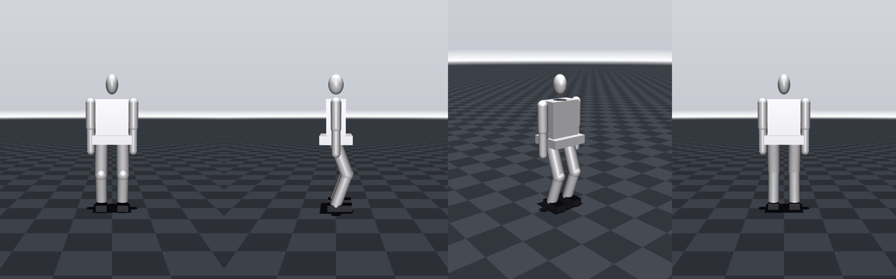

# Open Humanoid

**A toolkit for making the humanoid robot *you* want: any size, any budget, any CAD tool, with or without an AI brain.**

Open Humanoid isn't one robot. You describe the robot in a spec file. The toolkit sizes it, picks parts, prices it, simulates it, and guides an AI agent (or you) through CAD, walking, sourcing, and the build.

<p align="center"></p>
<p align="center"><i>Adam, the first reference variant: the current pre-CAD simulation model, generated straight from its spec.</i></p>

## How it works

```
 spec.yaml ──► oh size ──► oh bom ──► oh sim ──► CAD (any tool) ──► train walking ──► source ──► build
 "0.5 m,       torque,     priced     MuJoCo     export contract    RL in sim          verify     guide +
  $400,        speed,      parts      model +    → STEP/STL/mass    → policy           prices     bring-up
  walk"        servo pick  list       renders    → sim model
```

- **Requirements in, parts out.** You state height, budget, and gaits. `oh size` works out joint torques and speeds and picks the cheapest catalog actuator that can do it, from $4 hobby servos to $450 brushless units. It can also find **the tallest robot your budget allows**.
- **Honest numbers.** Every price carries `verified:` and a source. If a design can't run or can't afford a joint, the report says so and says why.
- **Sim from day one.** A MuJoCo model is generated from the spec before any CAD exists. CAD exports replace it later.
- **Any CAD tool.** build123d (code, so AI can author it fully), Onshape, SolidWorks, or FreeCAD. The pipeline only reads [standard exports](cad/EXPORT_CONTRACT.md).
- **Modular, optionally.** Standard [module interfaces](modules/INTERFACE.md) for swappable limbs, hands, and attachments, or `integrated` designs if you don't want modularity.
- **Optional brains.** The software core is control and safety. RL walking, LLM/MCP, teleop, and the rest are plugins.
- **Built for AI agents and teams.** A [one-shot prompt](prompts/oneshot/build-a-humanoid.md) with human review stops, a task and claim system so parallel agents don't collide, and session handoffs for when context runs out.

## Variants

| Variant | Status | Target |
|---|---|---|
| [**Adam**](variants/adam/) | concept | ≤ $400 all-in · tallest for budget (0.50 m today) · walks · sleek (Optimus / electric Atlas / Apple) |
| Eve | planned | ~$2k · bigger · `extends: adam` |

## Quick start

```bash
python -m venv .venv && .venv/Scripts/activate     # Linux/macOS: source .venv/bin/activate
pip install -e ".[sim,cad,dev]"
oh size adam && oh bom adam && oh sim test adam && oh render adam
oh new my-bot --extends adam                        # then edit variants/my-bot/spec.yaml
```

Full walkthrough: **[docs/getting-started.md](docs/getting-started.md)**.

## Documentation

| Doc | For |
|---|---|
| [Getting started](docs/getting-started.md) | Install, explore Adam, make your own variant, hand off to an agent |
| [Vision](docs/vision.md) | Why this exists, principles, roadmap |
| [Architecture](docs/architecture.md) | Data flow, layers, spec resolution, mass calibration loop |
| [Tools reference](docs/tools.md) | Every `oh` command and the sizing model's math |
| [Design language](docs/design-language.md) | Frame + shell, what "sleek" means |
| [Decisions](docs/decisions/) | Why things are the way they are (ADRs) |
| [AGENTS.md](AGENTS.md) | Rules for AI agents and contributors |
| [Coordination](coordination/README.md) | Tasks, claims, handoffs, orchestration profiles |
| [Prompts](prompts/README.md) | One-shot pipeline, part sourcing, session resume |

## Repo map

| Path | What lives there |
|---|---|
| `openhumanoid/` | Python framework + `oh` CLI. Variant-agnostic |
| `schemas/` | Contracts: spec, catalog part |
| `catalog/` | Parts database across budget tiers, one YAML per part |
| `modules/` | Reusable joints, limbs, hands, attachments |
| `variants/` | Concrete robots: spec, generated reports, CAD, build guide |
| `cad/` | CAD export contract + backend adapters |
| `sim/` | Simulation and locomotion training |
| `software/` | Robot runtime core + plugins |
| `prompts/` | Proven, versioned prompts |
| `coordination/` | Multi-agent tasks, handoffs, profiles |
| `docs/` | Everything above, explained |

## Status

v0.1: foundation. Sizing, BOM, sim generation, renders, and coordination work. CAD tooling, RL training, the software runtime, and live sourcing are next. See the [roadmap](docs/vision.md#roadmap-of-toolkit-capabilities) and `oh coord status`.

## License

Software: MIT · Hardware: CERN-OHL-S-2.0 · Docs: CC-BY-SA-4.0.
