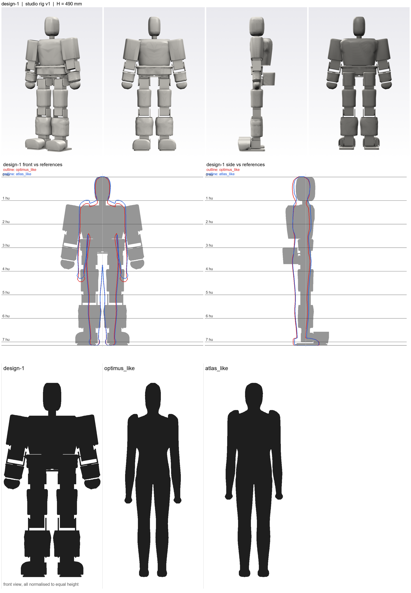
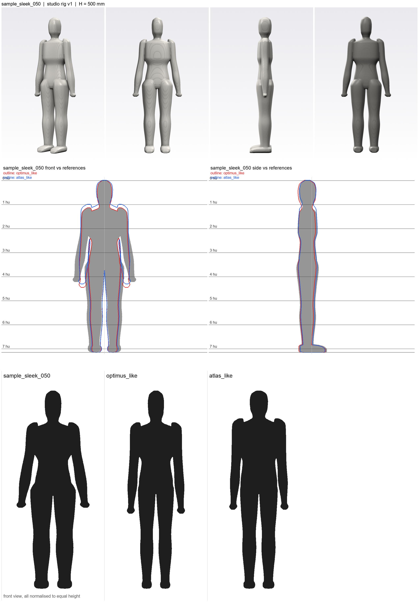

# Design method: silhouette first, outside-in shells, a blind critic, numbers from code

Implements [ADR 0010](decisions/0010-agent-design-method.md). Research behind it: `research/ai-engineering/06-industrial-design-and-visual-review.md`, `RECOMMENDATIONS.md` §A. Tooling lives in `openhumanoid/design/` (task T-0016). **No robot is designed here**; this is what later design sessions use.

**The one rule:** the agent that authors a design never grades its own look. Code measures the numbers, a separate critic judges the look, a human approves at the review stops.

## 1. Steps D0–D6

| Step | Output | Automated gate | Reviewer |
|---|---|---|---|
| **D0** brief + references | `design/brief.md`; `design/refs/*` front + side silhouettes at equal height | files exist | none |
| **D1** proportion + silhouette sheet (2D, minutes) | `design/profiles.yaml` + `oh design render` sheet with head-unit grid, reference outlines, hard points; `oh design metrics` | P*, S3, S4, HP bands (§4); hard points enclosed | critic, then **human R2a "silhouette"** (stop here) |
| **D2** massing in 3D | massing mesh generated *from* the profiles (`oh design massing`) | watertight; **S1: silhouette IoU vs approved D1 ≥ 0.95** | critic (pairwise vs D1 sheet + refs) |
| **D3** feature lines, splits, joints | panel lines along character lines, dark joint recess bands, visor | ≤ 1 visible seam per segment; reveal gaps 0.8–2 mm | critic |
| **D4** packaging closure | frame (inside-out) meets shell (outside-in) | clearance ≥ 1.5 mm; ROM sweep; S5 (no visible hardware) | none |
| **D5** surface + print prep | printable parts, zebra pass | overhang map; S4 | critic |
| **D6** final | render sheet, print layout, recalibrated mass/cost | everything above | critic (Opus allowed), then **human R3** |

D1–D2 are covered by the tooling in this task. D3–D5 need the CAD shell library (later work); the rig, metrics and critic already work on any mesh set, so they apply from D2 onward.

Structural rule: **`profiles.yaml` is the source of truth for the outer shape.** Shells are derived from it, never from servo boxes. Servo packages enter only as keep-out `hard_points` (and later as clearance checks).

## 2. Commands

```bash
.venv/Scripts/python -m openhumanoid.design render  <variant|profiles.yaml|mesh|dir|robot.xml> [--ref name=path ...] [--zebra]
.venv/Scripts/python -m openhumanoid.design massing <profiles.yaml> [--out x.stl]
.venv/Scripts/python -m openhumanoid.design metrics <variant|...> [--ref name=path] [--approved profiles.yaml] [--strict]
.venv/Scripts/python -m openhumanoid.design calibrate
.venv/Scripts/python -m openhumanoid.design verdict critic_a.json critic_b.json --step D1 --metrics design_metrics.json
```

Same commands as `oh design …` once `design.cli.register` is wired into `openhumanoid/cli.py` (see [tools.md](tools.md)); `oh render <id> --studio` is `render.render(spec, studio=True)`. Install: `pip install -e ".[sim,cad,dev,design]"`.

Outputs (variant `<id>`): `variants/<id>/generated/renders/studio/*` (render set + `sheet.png` + `studio.json`), `variants/<id>/generated/design_metrics.json`. Evidence from the validation run is committed under `docs/design-method/evidence/`.

## 3. `profiles.yaml` (schema: `schemas/design-profiles.schema.json`)

Metres; z up, x forward, y left, origin on the ground under the body centre. A **segment** is a loft along its axis; a **station** is one superellipse section `|u/(w/2)|^n + |v/(d/2)|^n = 1`:

```yaml
schema: design-profiles/0.1
height_m: 0.50
segments:
  - id: leg            # mirror: true emits leg_l (as written, y>0) and leg_r
    role: leg
    mirror: true
    k_m: 0.0015        # optional: smooth-union radius for this segment (default H/40)
    stations:          # strictly increasing z; w = y-extent, d = x-extent, n = squareness (2 ellipse, >6 boxy)
      - {z: 0.025, w: 0.030, d: 0.034, n: 2.3, cy: 0.056}
      - {z: 0.137, w: 0.040, d: 0.044, n: 2.3, cy: 0.056}
  - id: foot
    axis: x            # feet loft along x: stations carry x, w = y-extent, d = z-extent, cz = centre height
joints:      [{id: hip_l, pos: [0, 0.056, 0.25]}]                       # override landmark estimates in metrics
hard_points: [{id: thigh_servos_l, segment: leg_l, center: [0, 0.056, 0.222], size: [0.038, 0.028, 0.060], margin_m: 0.003}]
```

Station values interpolate with PCHIP (C¹, no overshoot), so the fewest stations that hold the shape give the smoothest surface. `oh design massing` evaluates each segment as a signed-distance field, merges them with a polynomial smooth-min (joints blend instead of creasing) and meshes the zero level with marching cubes (2 mm voxels at 0.5 m; Taubin-smoothed; vertex normals from the analytic field). `hard_points` are boxes that must sit inside the named segment with `margin_m` of wall + gap; the check feeds metric `HP`. A Gordon/loft production-shell library is **not** part of this task.

## 4. Rubric (numeric: code-measured. Source: `openhumanoid/design/rubric.yaml`)

H = total height, hu = head height. Measured on the fixed-framing orthographic silhouettes, so a mesh, a profile massing and a reference all go through the same algorithm. Landmarks (neck, crotch, shoulder band…) are *found* in the silhouette; `joints` from profiles or an MJCF override the hip/knee/ankle estimates (`P6_source`/`P7_source` in the JSON say which).

| ID | Criterion | Band | Gate |
|---|---|---|---|
| P1 | Head height / H | 0.11–0.15 | hard |
| P2a | Neck length / head height | 0.18–0.55 | soft |
| P2b | Neck width / head width (no stick) | ≥ 0.50 | hard |
| P3 | Outer shoulder width / H | 0.22–0.29 | hard |
| P4 | Waist / shoulder width | 0.50–0.75 | hard |
| P5 | Pelvis / shoulder width | 0.62–0.90 | soft |
| P6 | Hip-joint height / H | 0.46–0.53 | hard |
| P7 | Knee height / H | 0.25–0.30 | hard |
| P8a / P8b | Taper: distal / proximal section area, thigh / shank | ≤ 0.65 / ≤ 0.60 | soft |
| P9a / P9b | Widest point of thigh / calf, fraction from the top | ≤ 0.33 | soft |
| P10a / P10b | Foot length / H; foot height / H | 0.13–0.17; ≤ 0.05 | hard |
| S1 (S1a/S1b) | Silhouette IoU vs approved D1, front / side | ≥ 0.95 | hard |
| S2 | Silhouette IoU vs normalised references | report; soft target ≥ 0.80 | info |
| S3a / S3b | Silhouette ledges (horizontal steps in the outer edge); unintended leg-width bumps | ≤ 6; ≤ 3 | hard / soft |
| S4a / S4b | Share of surface in flat patches ≥ 0.002 H²; largest flat patch / its part | ≤ 0.30 | hard / soft |
| S5a / S5b | Servo/frame/horn pixels visible, front / side (painter's-algorithm raster; needs labelled parts) | ≤ 0.005 | hard |
| M1 | Printability: watertight parts, manifold3d-valid, bed fit. **Wall thickness, STEP round-trip, frame clearance and ROM sweep are NOT computed here** (listed under `M1_not_computed`); they belong to the CAD geometry gate | report | info |
| HP | Every hard point enclosed with wall + gap | all | hard |

**Gestalt (critic, §6):** G1 reads as an adult product, not a toy or character (no chibi head, no box torso) · G2 continuous silhouette: chest-waist-pelvis and thigh-shank flow, joints are deliberate dark recesses · G3 two-tone discipline: light shells, dark recesses, one accent at most · G4 consistent design language: same radii family and section squareness · G5 preferred over the previous best in **both** presentation orders · G6 next to each reference at equal height it looks like the same family.

### Calibration (read before using a band as a gate)

`oh design calibrate` runs the metrics over: three **reference** profiles (`human_canon`, `optimus_like`, `atlas_like`), two **counter-examples** (`toy_chibi`, a synthetic chibi/boxy robot, and `adam_cad_v0`, the real Roblox-look CAD meshes from `variants/adam/cad/export/`) and the demo `sample_sleek_050`. Result (`docs/design-method/calibration.json`):

| metric | human | optimus | atlas | **toy_chibi** | sample sleek | **adam_cad_v0** |
|---|---|---|---|---|---|---|
| P1 head / H | 0.125 | 0.133 | 0.112 | 0.183 | 0.133 | 0.142 |
| P2b neck / head width | 0.72 | 0.70 | 0.69 | 0.63 | 0.66 | **0.43** |
| P3 shoulder / H | 0.280 | 0.265 | 0.276 | **0.452** | 0.282 | **0.476** |
| P4 waist / shoulder | 0.61 | 0.55 | 0.60 | 0.74 | 0.54 | **0.39** |
| P6 hip height / H | 0.52 | 0.52 | 0.52 | **0.36** | 0.505 | 0.505 |
| P8a thigh taper (area) | 0.51 | 0.58 | 0.61 | **0.90** | 0.61 | 0.66 |
| P10a foot length / H | 0.153 | 0.151 | 0.142 | **0.222** | 0.162 | **0.190** |
| P10b foot height / H | 0.030 | 0.030 | 0.030 | **0.056** | 0.036 | **0.069** |
| S3a ledges | 2 | 2 | 2 | 4 | 2 | **30** |
| S4a flat-area share | 0.05 | 0.03 | 0.07 | **0.42** | 0.04 | **0.58** |
| numeric criteria passed | 18/18 | 18/18 | 18/18 | 7/18 | 19/19 | **5/20** |

The numeric rubric separates "sleek" from "toy" on this set (lowest reference 100 %, highest counter-example 39 %). Adam CAD v0 shoulder width measures **0.476 H** orthographically, in line with the 0.45 that research 07 §4 found by pixel analysis of the perspective render, and 1.8× the human band. **Caveats, stated plainly:**
- The three reference profiles are **approximated** from public dimensions and press images, not pixel-measured; each file lists its `sources` and `confidence: low/approximate`. Heights: Optimus Gen 2 1.73 m / ~56 kg (aggregator, unconfirmed by Tesla); electric Atlas 1.9 m / 90 kg (Boston Dynamics spec sheet, as reported by search; PDF not opened). All other proportions are my visual estimates (±15 %). The human canon uses Drillis & Contini / Winter fractions recalled from memory, not re-verified.
- Bands were **widened** where the references fell outside the research start values (P1, P2a, P3, P4, P5), and **raised** for P2b (0.40 → 0.50, because refs and human anatomy sit at 0.65–0.72 and the stick neck of Adam CAD v0 is 0.43). The changes are logged per metric in `rubric.yaml`. With n = 3 approximate references the references passing 100 % is partly by construction. **The rubric is `provisional` until the maintainer supplies measured silhouettes** (`oh design metrics --ref photo_silhouette.png` thresholds an image onto the same framing) and `calibrate` is re-run. Until then treat hard-gate failures as strong evidence of a problem and passes as "not obviously wrong".
- Some metrics do not discriminate on this set (P9a/P9b, P8a: Adam CAD v0 fails P8a by 0.01). They stay as soft gates.
- The massing's own flatness (S4) is near zero by construction, so S4 is only informative on CAD meshes.

## 5. Studio render rig (`openhumanoid/design/rig.yaml`, committed)

- **Clay views** (pyvista, offscreen): front, ¾, side, back; one matte material, SSAO, 3-point light (key/fill/rim), 85 mm-equivalent lens (24 mm sensor), camera nearly level so verticals stay vertical; vertex normals taken from the analytic field for massings, split at sharp edges (35°) for CAD meshes.
- **Orthographic silhouettes** (front, side) rasterised exactly on a fixed canvas: 1200 × 1200 px, height H → 1000 px, ground at row 1100, bbox-centred. The same framing feeds the metrics and the reference comparison. Constants live in `silhouette.py` and `rig.yaml`; a test fails if they diverge. Change them only by decision record.
- **Overlays**: head-unit grid (`n hu` lines from the crown), reference outlines at equal height (`--ref name=path`, path = profiles / mesh set / MJCF / silhouette PNG), and an **equal-height lineup** of candidate + references.
- **Zebra pass** (`--zebra`): stripe reflection from per-vertex normals. Clean nested ovals = G1/G2 continuity; fragmenting stripes at a join show where blends are not smooth (it correctly flagged the pelvis/shoulder joins of the sample massing).
- **Inputs**: any mesh set (STL/GLB/OBJ/PLY, a directory), a profiles file (massing generated), or an MJCF (visual geoms of `robot.xml`, neutral pose, parts classified `shell`/`hardware` from names like `__servo`, `__frame`).
- **Output**: `variants/<id>/generated/renders/studio/`: `clay_*.png`, `silhouette_*.png`, `overlay_*.png`, `lineup_*.png`, `zebra_*.png`, `sheet.png` (the file the critic gets), `studio.json`.
- MuJoCo renders (`oh render <id>`) remain for simulation only.

## 6. The critic (`.claude/agents/design-critic.md`)

Read-only (`tools: Read`), `model: sonnet` (use Opus only at R3). It receives **only**: the render sheet(s), reference images, the metrics JSON, and the brief. No code, no transcript, no opinion of the design. Its prompt contains the gestalt rubric above; `tests/test_design.py` fails if the ids or wording drift between this doc, `rubric.yaml` and the agent.

**Protocol for the orchestrator (the authoring session):**
1. After a design step: run `oh design render … --ref …` and `oh design metrics …` (use a neutral `--name` so the sheet does not say which design is whose).
2. Call `design-critic` **twice** with `ORDER: cand_first` and `ORDER: cand_second` (same files, order swapped) when a `BASELINE` (previous best) exists; once with `ORDER: single` otherwise.
3. `oh design verdict a.json b.json --step D1 --metrics design_metrics.json [--state critic_state.json]` combines them with fixed rules (`critic.py`): **UNCERTAIN = no-pass**; a criterion passes only if every report passes it; the pairwise preference counts only if the candidate wins in *both* orders; **numeric hard-gate failures override the critic**; at most **3 rounds** per step, after which the verdict says to keep best-so-far and escalate to the human.
4. Apply only the `top_changes` tied to failed criteria (each names a `profiles.yaml` parameter), re-render, repeat. Metrics stay the authority on anything numeric: the critic quotes them, never estimates them.

The critic's output is one JSON block: `reads_as` (product / toy / unfinished), per-criterion verdict + evidence, `pairwise.preferred`, ≤ 3 `top_changes`, `notes`.

**Limits.** No Claude judgement of industrial-design aesthetics has been validated against the maintainer; put 5–10 maintainer-rated images in its context and check agreement on ~10 labelled images before trusting it as a gate (07 §4). The clay views cannot show colour, so G3 (two-tone) is judged from geometry and will read UNCERTAIN until recess/visor geometry exists. Only silhouettes of the references are available (no photographs have been collected).

## 7. Validation run (end to end, committed evidence)

Blind critic (Sonnet, sheet + zebra + metrics only; designs renamed `design-1` / `design-2`) on the Adam CAD v0 meshes (Roblox look) vs. a smooth massing from `openhumanoid/design/sample/sample_sleek_050.yaml`. The custom agent could not be registered inside the session that wrote it, so each run used a general-purpose Sonnet agent told to read `design-critic.md` and follow it with `Read` only; a normal session loads the agent directly.

| Run | Result |
|---|---|
| design-1 (Adam CAD v0) alone | `reads_as: unfinished`; **G1, G2, G3, G4, G6 all FAIL**, with specific evidence (slab shoulders with a horizontal ledge, stick neck, stacked boxes with gaps, exposed hardware); metrics: 15 of 20 numeric criteria fail, 9 hard gates (P2b, P3, P4, P10a/b, S3a, S4a, S5a/b) |
| design-2 (smooth massing) alone | `reads_as: unfinished`; G1 FAIL, G2 FAIL, G3 UNCERTAIN, G4 FAIL, G6 UNCERTAIN; metrics 19/19 |
| pairwise, candidate = design-2, order `cand_first` | preferred **candidate** |
| pairwise, candidate = design-2, order `cand_second` | preferred **candidate** (G1 PASS, G4 PASS, G6 PASS, G2 FAIL, G3 UNCERTAIN) |
| `oh design verdict` on the pair | **G5 PASS** (candidate preferred in both orders), overall `pass: false` because G2/G3 fail, as it should: the massing has no joint recesses or visor yet |

So the toy is failed (5/5 gestalt FAIL + 9 numeric hard failures), the smooth one is preferred in both orders, and the critic does **not** wave the smooth massing through: it calls it a faceless mannequin and ties its top changes to profile parameters (joint-recess stations, visor face plane, hip/thigh flare, chest roundness). Its station names are guesses (it never saw the YAML, by design); the author maps them. Files: `docs/design-method/evidence/` (`adam_cad_v0/`, `sample_sleek_050/` render sets + `design_metrics.json`; `critic/` the four raw reports and the combined verdicts).




One run per condition is an anecdote, not a calibration.

## 8. Known gaps

- No production shell library (section-loft solids, Gordon panels, STEP): later CAD work. The massing is mesh-only and not printable as is.
- M1 beyond watertight/manifold/bed-fit, and S5 for profile-only designs, need the frame model (D4).
- S5 and the CAD-assembly pose use the MJCF neutral pose (all joints 0); arms hang straight.
- References are approximations; see §4. The first thing to do when a maintainer supplies photos: re-run `calibrate` with measured silhouettes.
- `oh` wiring: `openhumanoid/design/cli.py:register(sub)` and `render.render(spec, studio=True)` exist but `openhumanoid/cli.py` is untouched in this task (see the T-0016 handoff).
