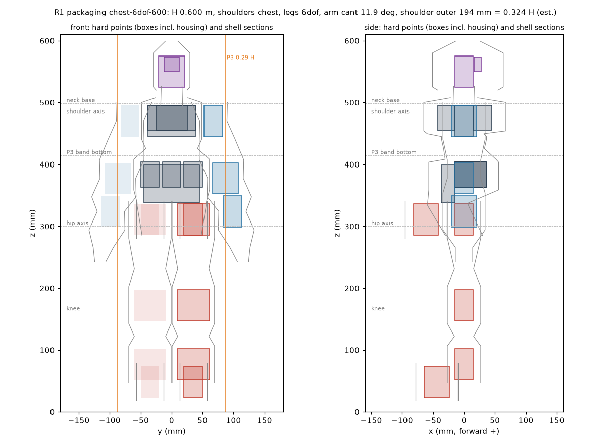
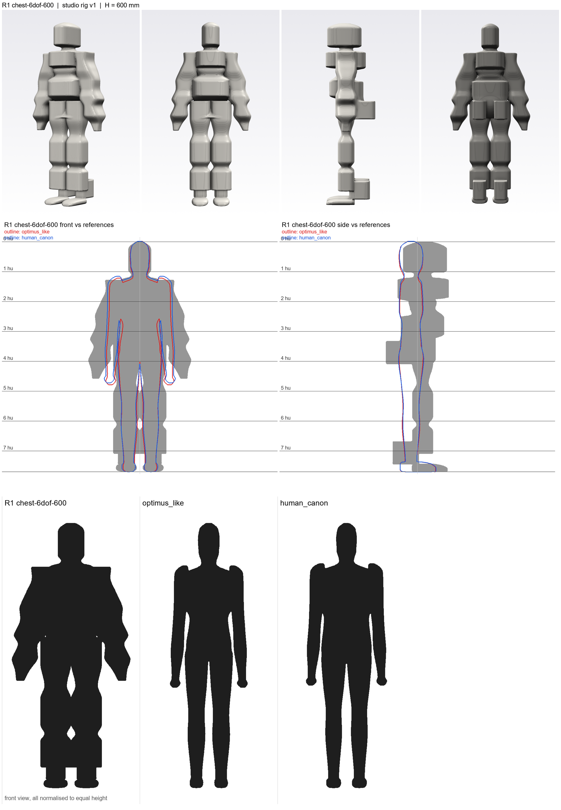

# R1 Concept review: Adam (2026-10-19) — PROVISIONAL

**Phase:** P2 concept loop · **Task:** T-20261019-36f9 · **Status:** PROVISIONAL, signed by nobody yet. The commander signs it as provisional; the maintainer decides; the challenger (#3) reviews it before `spec.yaml` changes. **Everything here is provisional until the bench identification of one 12 V and one 7.4 V STS3215** (ADR 0014 section 3).

Gate sets (ADR 0014): candidates are **ranked on the ODM-calibrated gates** (strict peak, RMS and envelope relaxed by the measured Open Duck Mini factors ×1.52 / ×1.94 / ×1.18; overload, motion validity, tether and R10 are *not* relaxed). The **strict (datasheet) set is reported beside it everywhere**. Thresholds were not changed.

## 1. Recommendation

| | **Path 1: full requirements (RECOMMENDED)** | Path 1 runner-up | **Path 2: the $550 cap (RECOMMENDED for this path)** | Path 2 runner-up: what $550 literally buys |
|---|---|---|---|---|
| Concept file | `concepts/R1-P1-0p60-3s-sts3250-knee-hiproll.yaml` | `concepts/R1-P1r-0p55-3s-sts3250-knee-hiproll.yaml` | `concepts/R1-P2-0p55-3s-21dof.yaml` | cost row only (fails MUSTs in the engine) |
| Height | **0.60 m** | 0.55 m | 0.55 m | 0.55 m |
| Joints (servos) | 23: legs 2×6, waist yaw, neck yaw+pitch, arms 2×3, 2 grippers | same 23 | 21: legs 2×6, neck yaw+pitch, arms 2×3, **1** gripper; **no waist** | 14: legs 2×**5** (no ankle roll), neck yaw, **one** arm (shoulder pitch+roll) + gripper |
| Actuators | **STS3250 12 V at knees + hip roll (4)**, STS3215 12 V (C047/C018) elsewhere (19) | same | STS3215 12 V × 21 | STS3215 12 V × 14 |
| Bus / battery | 3S (11.1 V), Tattu 3S 1300 mAh 14.4 Wh, 15 A fuse | same | same, 10 A fuse | same |
| Compute | **Raspberry Pi 5 1 GB** + Pololu D36V50F5 | same | Pi 5 1 GB + DFR0831 4 A buck | same as path 2 |
| Mass nominal / band | **4.60 kg** / 3.44–5.77 | 4.01 / 3.11–4.80 | 3.87 / 2.98–4.73 | not run |
| Worst margin, calibrated / strict (nominal) | **1.55 / 1.02** (hip roll) | 1.89 / 1.25 | 1.22 / **0.80 FAIL** | walking invalid (see 4.3) |
| Calibrated gates across the 11 tornado bounds | **10 / 11 pass**, min margin 1.16 (stall −25 %); the 11th = walk tether 1.0 % at armature +50 % | 9 / 11 | 5 / 11 | — |
| Monte Carlo p95 peak / stall (cal. limit 1.064, strict 0.70) | **1.02** (cal. pass, strict fail) | (report pending, see 8) | 1.29 (cal. **fail**) | — |
| R10 largest recoverable push, weakest scenario (need 0.45 N·s) | **0.93 N·s** (walk fwd) — 2.1× | 0.67 N·s (walk fwd) | 0.57 N·s (walk lat-in); **fails** at the required 0.45 under 5 of 11 bounds | — |
| Runtime, mixed activity | **24.9 min** (19 min if charged to 4.0 V/cell for the STS3250 rating) | 20+ min | 26.4 min | — |
| Knee ROM | **0–110°** | 0–110° | 0–115° (CAD limit) | — |
| R1 total = verified parts + spares + tax + est. shipping, **+10 %** | **$1,505** (fast-US $1,707); sticker $1,101 | $1,490 | **$942** ($868 without spares); sticker $678 | $695; sticker **$532** |
| Fits $550? | no | no | **no** | sticker only |
| MUSTs (engine-checked) | all pass on calibrated gates | all pass | all pass nominal, fragile | **R2 walk, R3 wave, R5 pickup fail**; R7 reduced |

**My recommendation: Path 1, R1-P1 (0.60 m, 3S, STS3250 at knees and hip roll, Pi 5 1 GB), as PROVISIONAL.** Reasons, in the ranking order the brief set:
1. **MUSTs:** every engine-checked MUST passes on the calibrated set, including R10 at 2.1× the provisional push, and it is the only candidate whose calibrated Monte Carlo p95 also passes (§4.2).
2. **Robustness:** it survives 10 of 11 tornado bounds on the calibrated set with ≥ 1.16 margin; no all-STS3215 concept survives more than 5 (§4.2). It even passes the *strict* gates at nominal.
3. **Cost:** it is the most expensive engineering option ($1,505). The four STS3250 cost +$314 over the all-STS3215 build at the same height ($1,490 vs $1,176 at 0.55 m). That buys the robustness above; the bench can give it back (§6).
4. **Look:** 0.60 m is the tallest height that passes; taller is better for every look metric (§3), and nothing taller passes the calibrated gates with these servos.

**Path 2 ($550):** the cap **cannot be held** by any concept that keeps the MUSTs. The cheapest MUST-keeping concept is $942 under the project's accounting (or $678 sticker). What $550 literally buys is 14 servos, and that robot loses R2, R3 and R5 in the engine (§5).

## 2. Joint list and actuators (Path 1 recommended)

| Segment | Joints | Actuator | Range used (deg) | Why |
|---|---|---|---|---|
| Hip | yaw, **roll**, pitch | STS3215 12 V, **STS3250**, STS3215 12 V | yaw ±45, roll −30/+45, pitch −110/+40 (CAD-limited) | hip roll is the binding joint above 0.5 m in every sweep (`generated/concept/sweep/*.md`, `design/r1_results/R1x-a23.md`) |
| Knee | pitch | **STS3250** | **0–110** | second binding joint; knee-ROM decision §7 |
| Ankle | pitch, roll | STS3215 12 V | pitch −60/+25 (CAD), roll ±30 | ankle roll stays: 5-DOF legs fail the walk (§4.3) |
| Waist | yaw | STS3215 12 V | ±90 | R7 torso orientation; costs no height when it sits between the hip-yaw servos (§3.1) |
| Neck | yaw, pitch | STS3215 12 V | yaw ±90, pitch ±30 | R7 (look up at a person); camera in the head |
| Arm ×2 | shoulder pitch, shoulder roll, elbow | STS3215 12 V | spec | R3 wave needs abduction + elbow; R5 needs reach |
| Hand ×2 | parallel-jaw gripper | STS3215 12 V | 58 mm opening | R5 (one would do; the second is a cut in path 2) |

All on one 11.1 V bus. The STS3250 is rated 12 V: a full 3S (12.6 V) is over its rating for 23 % of the discharge. Mitigation: charge to 4.00 V/cell, which costs ~23 % of capacity (engine report §Power).

## 3. Packaging and the minimum not-a-toy height (challenge-1 row 1)

Tool: `variants/adam/design/r1_packaging.py`. It builds hard-point boxes for every servo, the pack, the Pi 5 bay and the camera, using catalog `dimensions_mm` and the CAD-foundation facts. It wraps them in the smallest superellipse shell family (housing 2.65 mm, shell gap + wall 3.1 mm) on adult proportions, and runs `oh design metrics` on that massing. Outputs:
- `variants/adam/design/r1_packaging/summary.md`
- `docs/design-method/R1/hardpoints_*.png` (front + side)
- `docs/design-method/R1/studio_*/sheet.png`

Other renders:
- `studio_arm-6dof-600/` (servo in the arm)
- `studio_chest-5dof-600/` (no ankle roll)
- `studio_chest-6dof-725/` (the first height that passes P3)

### 3.1 Packaging choices (challenge these)

- **Hip-yaw servos run long-axis fore-aft.** The waist-yaw servo then fits between them inside the 106 mm hip stack, so the waist costs no torso height. With the CAD-foundation orientation (across the pelvis) it would cost ~46 mm.
- **Pi 5, bus adapter, buck and IMU** sit in the rear pelvis above the hip-roll servos.
- **The 3S 1300 pack** goes across the upper back behind the shoulder servos. A 3S 2300 is 106 mm long and would widen the chest.
- **The neck-yaw servo** sits in a front chest slot.
- **The elbow servo** goes in the upper arm.
- **The arm rests at the smallest A-pose cant that clears the hips.** The hips are 128 mm across: two 52 mm pitch forks at the 70 mm servo-fixed spacing. The 37 mm-thick arm servos hit them when hanging straight. The cant needed is 15.7° at 0.50 m, 11.9° at 0.60 m and 6.6° at 0.725 m.

### 3.2 Results (measured `oh design metrics` on the massing; P3 band ≤ 0.29 H)

| Layout | P3 at 0.55 / 0.60 / 0.65 / 0.70 / 0.725 / 0.75 m | P3 passes from | Other hard gates |
|---|---|---|---|
| **Shoulder pitch in the chest**, 6-DOF legs | 0.399 / **0.364** / 0.336 / 0.298 / 0.288 / 0.279 | **≈ 0.72 m** | P10a foot length 0.18–0.21 H at every height: the ankle-roll servo block behind the ankle reads as foot. S3a ledges 6–8, a massing artifact at the band edge |
| Shoulder pitch in the arm, 6-DOF | 0.414 / 0.374 / 0.340 / 0.304 / 0.293 / 0.282 | ≈ 0.73 m | P10a as above; P4 drops below 0.50 at ≥ 0.65 m |
| Chest, 5-DOF legs | same P3 as chest 6-DOF | ≈ 0.72 m | **all others pass** (no heel block) |
| Arm, 5-DOF | same as arm 6-DOF | ≈ 0.73 m | P4 |

**The minimum height at which the numeric not-a-toy rubric passes is about 0.72 m (chest layout) or 0.73 m (arm layout).** That is above the 0.40–0.65 m design space, and above every height the engineering gates accept (§4).

The shoulder band is ~185–195 mm almost regardless of height, because it is set by servo thickness, not proportion. Inside the design space the best achievable P3 is about 0.34–0.36 H at 0.60–0.65 m. For scale: the references measure 0.265–0.28, the chibi counter-example 0.45, Adam CAD v0 0.476 (`docs/design-method.md` §4).

**Chest beats arm by 0.01–0.02 H at every height, so the shoulder-pitch servos go in the chest.**

Caveats:
- The massing is the minimal enclosure, not a styled shell; its side view is deeper than a designed one.
- The rubric is calibration-pending (n = 3 approximate references).
- No critic was run on these sheets. They are packaging evidence, not R2a.

## 4. Engineering feasibility (strict vs calibrated)

### 4.1 Tool and design space

Tool: `variants/adam/design/r1_calibrated.py`, which calls the engine's own `gait_sweep` / `run_bundle` / `pushcheck`. Per candidate × height it records:
- nominal performance plus the 10 tornado bounds and the benchmark-fit mass;
- strict and calibrated margins per joint;
- R10 at the required 0.45 N·s;
- the largest recoverable push.

Packaging floors are `[t0004, cad_foundation]`. Results are in `variants/adam/design/r1_results/<id>.md|json`.

The candidates span every architecture axis:
- power: 3S / 12 V vs 2S / 7.4 V;
- STS3250 placement: none / knees / hip roll / both;
- legs: 6-DOF vs 5-DOF;
- upper body: full / no waist / no elbows;
- height: 0.50–0.65 m.

### 4.2 Summary

Calibrated pass = every joint gate (calibrated) + every valid motion + R10. "Bounds" are calibrated passes out of 11.

| Candidate (servos) | 0.50 m | 0.55 m | 0.60 m | 0.65 m |
|---|---|---|---|---|
| **R1x-ckh23**: STS3250 knee + hip roll (23) | strict ✔ cal ✔ 9/11 | strict ✔ cal ✔ 9/11 | **strict ✔ cal ✔ 10/11**, R10 0.93 | cal ✔ strict ✘, 7/11 |
| R1x-ck23: STS3250 knees (23) | cal ✔ 7/11 | cal ✔ 6/11 | cal ✔ 4/11 | ✘ (R10 walk) |
| R1x-ch23: STS3250 hip roll (23) | — | cal ✔ 7/11 | ✘ knee | ✘ |
| R1x-a23: all STS3215 12 V (23) | ✘ R10 walk lat-in 0.40 | cal ✔ 5/11 | ✘ knee 0.84 | ✘ |
| R1x-a22-nowaist (21 build) | — | cal ✔ 5/11 | ✘ | — |
| R1x-b23: 2S / 7.4 V (23) | ✘ R10 0.17 | ✘ | ✘ | ✘ |
| R1x-a21 / b21: 5-DOF legs | **walks invalid** (tether 1.3–1.8 % > 1 %) at every height | | | |
| R1x-a20 / a18 cuts (5-DOF, no waist, ± no elbows) | walks invalid; without elbows wave and pickup are also invalid | | | |

Monte Carlo (16 samples, `generated/concept/<id>/report.md`), p95 peak / stall (calibrated limit 1.064, strict 0.70):
- R1-P1: 1.02
- R1-P1b (knees only, 0.55 m): 1.27
- R1-P2: 1.29

Only R1-P1 passes on the calibrated set.

### 4.3 Findings that set the design

1. **Ankle roll stays.** With 5-DOF legs the frozen walk needs 1.3–1.8 % body weight of tether (limit 1 %) at every height and in both architectures. Open Duck Mini walks with 5 DOF under an RL policy and a knock-kneed stance (`docs/concept-engine.md`). The engine's LIPM gait cannot show that, so dropping the roll is unsupported by evidence and rejected for R10/R2. The look would prefer 5-DOF: no heel block, P10a passes (§3).
2. **7.4 V / 2S is out.** It fails R10 walking pushes at every height (largest 0.17 N·s at 0.50 m), because its no-load speed is the binding limit in the walking push cases.
3. **The hip roll binds above 0.5 m, then the knee.** Upgrading only one of them moves the ceiling ~0.05 m. Upgrading both makes 0.60 m robust.
4. **R10 grows with height.** The weakest push is 0.40 N·s at 0.50 m (A) but 0.93 N·s at 0.60 m (ckh). The provisional 0.45 N·s is a smaller velocity change on a heavier robot.
5. **R5 table height.** At 0.60 m the frozen 150 g pickup is:
   - valid with margin at 0.30 and 0.35 m tables;
   - valid at 0.45 m with the shoulder at 0.77 of stall (calibrated pass, strict fail);
   - out of reach at 0.50 m;
   - an artifact at 0.40 m: a 131× stall spike, probably hand–table contact, to inspect.

   Source: `design/r1_results/tables_R1-P1-*.json`. The engine's fixed `pickup_0.45m` case reports "arm too short" for every candidate: a planner gap, not the robot.

## 5. Budget paths in detail

Tool: `variants/adam/design/r1_cost.py`. It imports every price, tax, shipping and tariff from `sourcing/totals.py` (T-0002, URLs in `QUOTES.md`). The only additions are:
- the Pi 5 1 GB: Adafruit #6447, $49.50, in stock 2026-10-19;
- the Zero 2 W kit;
- filament scaled from the engine's structure mass: 2.28 kg at 0.55 m, 2.96 kg at 0.60 m.

Full table: `design/r1_results/cost.md`.

- **One more STS3215 costs $27.93** at the R1 accounting.
- The lean non-servo floor costs $341: phone controller, B3 charger, ICM-42688 IMU, camera, Pi 5 1 GB.
- **$550 therefore leaves room for 8 servos.** A walking biped needs at least 10 for legs alone.

**What Path 2 (R1-P2, $942) loses against Path 1:**
- the waist yaw (R7 by neck yaw + turning in place);
- the second gripper;
- the gamepad (a phone, which R9 allows);
- the B6neo charger (a slow B3, unverified);
- the BNO085 (an ICM-42688, unverified, needs our own fusion);
- the STS3250s, and with them the robustness: 5/11 bounds, MC p95 fails, R10 fails under 5 bounds;
- 5 cm of height.

**What the literal $550 (sticker) robot loses on top:**
- ankle roll: the walk becomes invalid in the engine;
- elbows and the whole left arm: wave and pickup are invalid;
- neck pitch;
- spares.

Even it is $695 delivered with contingency.

## 6. What the bench test (one 12 V + one 7.4 V STS3215) can overturn

| Bench outcome | Effect | Fallback / action |
|---|---|---|
| 12 V stall ≥ ~1.5× datasheet (as ODM's 7.4 V sim limit suggests) and anchored curve | All-STS3215 R1x-a23 at 0.55 m becomes robust | **Drop the four STS3250** (−$314, to $1,176) at 0.55 m; keep 0.60 m only if A also passes there |
| 12 V curve is the pessimistic linear one, or stall −25 % | R1-P1 still passes calibrated (1.36 / 1.16) | none; all-STS3215 options are dead |
| 7.4 V real stall ≈ datasheet and thermal-hold continuous ≈ 0.49–0.64 N·m | The ODM calibration factors themselves shrink: strict gates govern | R1-P1 passes strict at nominal but only 5/11 bounds: **fall back to R1-P1r (0.55 m, 8/11 strict bounds)** or 0.50 m (strict ✔) |
| 12 V armature ≥ +50 % of the borrowed 7.4 V value | Walk tether reaches 1.0 % (the one calibrated bound R1-P1 fails) | drop to 0.55 m |
| Anything about the STS3250 | **Not measured by this bench**: its model is datasheet-only (±25–30 % stall, ±50 % armature) and it now carries the knees and hip roll | add one STS3250 to the bench order (question 3) |

## 7. Knee ROM decision: **110°**

| Knee range | Calf pocket (share of shank envelope, bake-off) | Engine at 0.60 m |
|---|---|---|
| **110°** | **15.5 %** | margins and R10 **identical** to 115° (`r1_results/R1x-ckh23-knee110.md`) |
| 115° (CAD limit today) | ~17 % (interpolated) | squat_120 and sit-to-stand 130 run clamped |
| 130° | 23.7 % | needs a CAD change: heel meets glute at 118° |

Squat depth is clamped at 110° either way, and the sit-to-stand SHOULD proxy (run at the limit) still passes. 110° costs nothing measurable and halves the look penalty against 130° (challenge-2 row 17).

## 8. Compute

The **Raspberry Pi 5 1 GB** is the recommendation:
- $49.50, in stock at Adafruit, read 2026-10-19 by the compute check;
- 85 × 56 mm, ~9 W under stress per Jeff Geerling's measurement;
- YOLO-class person detection at ~15 FPS at 640 px with NCNN (Ultralytics Pi guide);
- the walking MLP is trivial for it.

The Pi Zero 2 W is out of stock as a board at every US vendor checked. The only in-stock route is a $74.95 starter kit, and it does 1.7–1.9 FPS SSDLite / YOLOv8n-320, which is enough for R7 but costs more than the Pi 5 1 GB.

Rejected alternatives:
- Pi 4 2 GB: $67.50, more power for less;
- Radxa Zero 3W: out of stock, no Camera Module 3 support listed;
- Orange Pi Zero 2W: no CSI.

The catalog has only the Pi 5 4 GB. The concept files use it as the stand-in for mass, size and power, and a sourcing task must add the 1 GB part.

## 9. Risks

1. **The calibration is thin.** One known robot, one gait, measured at 7.4 V and applied to the 12 V STS3215 and the STS3250 by assumption (ADR 0014).
2. **The STS3250 rests on a datasheet only.** It has a single credible vendor (OpenELAB, pre-order 10–20 working days), and a full 3S is over its 12 V rating.
3. **Look:** P3 is 0.36 H at 0.60 m, against a 0.29 band. Inside 0.40–0.65 m no layout reaches the band (§3). R2a will see wide, servo-forced shoulders and arms that rest at a 12° cant.
4. **The 6-DOF ankle block fails P10a** (foot reads 0.19 H). A styled heel and toe treatment in R2a may fix the silhouette; the metric is fragile here (P10b flips between 0.03 and 0.11 at 0.65–0.70 m).
5. **The engine's foot floor conflicts with the look.** The engine scales the T-0004 foot floor (92 mm at 0.5 m = 0.184 H), but P10a allows ≤ 0.17 H. R10 margins rest on a foot ~8 % longer than the look allows. Re-check after the foot is designed.
6. **Mass is a pre-CAD guess.** Structure is 2.57 kg of 4.60 kg; at structure ×1.4 (5.62 kg) R1-P1 still passes calibrated (1.28).
7. **R10 (0.45 N·s) and R5 (table 0.40–0.50 m) are still provisional.** The 0.45 m pickup passes only on the calibrated set, and the 0.40 m case shows an unexplained spike.
8. **Bus current:**
   - peak 9.4 A, 15 A fuse;
   - the all-leg stall fault is 35.5 A and needs a 50 A part to ride through (engine report);
   - the STS3215 connector rating is unknown.
9. **Budget:** Path 1 is 2.7× the cap. Tariff exposure is +$183 if the servos are not DDP (`cost.md`).

## 10. Questions for the maintainer (3)

1. **Budget:** $550 cannot be held by any concept that keeps the MUSTs. Do you approve **Path 1 (~$1,505, robust)**, Path 2 (~$942, fragile, no waist, one gripper), or a new cap?
2. **Look vs height:** the numeric not-a-toy shoulder band needs ≈ 0.72 m, which these servos cannot carry. Do you accept P3 ≈ 0.36 H at 0.60 m going into R2a (the stylist then works on reading, not on numbers)? Or should a stronger actuator tier above 0.65 m be studied (T-0009)?
3. **Bench order:** add **one STS3250** (~$74, OpenELAB) to the two STS3215 bench servos, since Path 1 now puts it at the knees and hip roll and nothing measures it?

## Evidence index

- Engine reports:
  - `variants/adam/generated/concept/R1-P1-0p60-3s-sts3250-knee-hiproll/report.md`
  - `R1-P1r-0p55-3s-sts3250-knee-hiproll/`
  - `R1-P2-0p55-3s-21dof/`
  - `R1-P1b-0p55-3s-sts3250-knee/` (alternative)
- Strict vs calibrated sweeps: `variants/adam/design/r1_results/*.md|json` (script `design/r1_calibrated.py`).
- Packaging: `variants/adam/design/r1_packaging/summary.md` (script `design/r1_packaging.py`); images in `docs/design-method/R1/`.
- Cost: `variants/adam/design/r1_results/cost.md` (script `design/r1_cost.py` → `sourcing/totals.py`, `QUOTES.md`).
- Table heights: `variants/adam/design/r1_results/tables_R1-P1-0p60-3s-sts3250-knee-hiproll.json` (script `design/r1_tables.py`).
- Calibration: ADR 0014; `generated/concept/calibration/odm_calibration.md`.
