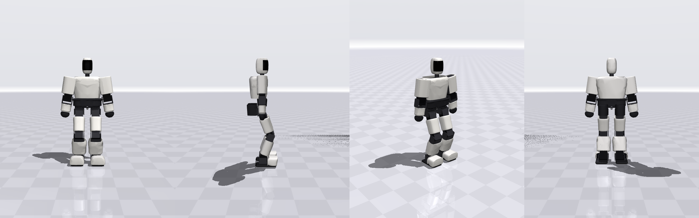
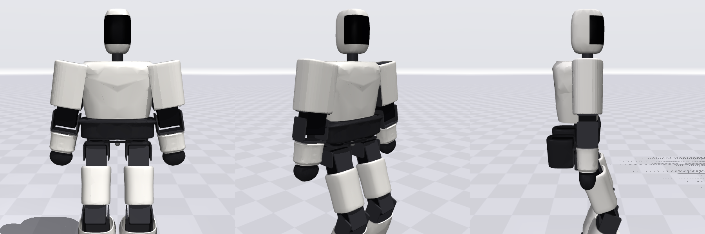
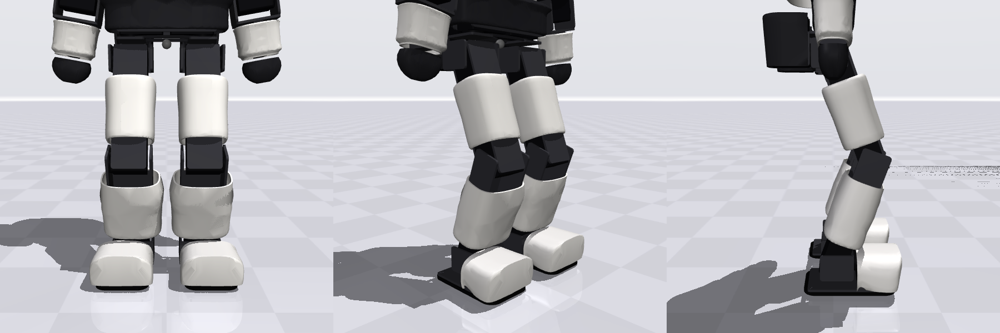

# R2 Concept look: Adam (2026-10-19)

**Phase:** P3 Mechanical, early · **Task:** T-0004 · **Status:** waiting for the maintainer

## What you're looking at

`oh cad build adam` generates the frame and rough shells from `spec.yaml` + `generated/sizing.json` + the catalog. It uses the new generic build123d template `biped_v1` and Adam's look file `variants/adam/cad/style.yaml`. `oh render adam` renders the CAD-derived MJCF (`cad/export/robot.xml`) in the walking stance.

| Upper body | Legs |
|---|---|
|  |  |

## Against the references

| Reference cue (design-language.md) | R2 | Notes |
|---|---|---|
| Optimus: white shells over black structure | ✅ | Matte warm-white shells, graphite frame, black servos |
| Optimus: black waist band between chest and legs | ✅ | Pelvis band printed dark; hip caps dark too |
| Optimus: glossy faceless visor head | ✅ | Pill head with a front visor window (black PETG, polished) |
| Optimus: tapered limbs with a "muscle" swell | △ | Profiles exist (thigh tapers, calf swells), but servo sections dominate. Limbs read nearly cylindrical |
| Atlas: capsule/cylinder primitives, calm surfaces | △ | Soft squircle sections (n = 3). Shoulder caps read boxy |
| Atlas: zero visible cables, compact hips | △ | Cables not modelled yet. Hips are 143 mm wide (two yaw servos side by side) |
| Apple: few radii, one material look, flat deliberate planes | ✅ | Flat inner faces on the arms, one accent (dark) |
| Dark recessed joint bands, no visible servos from front/side | ✗ | Joint bands are **servo-sized (25–45 mm)**, not 2–3 mm. Servo bodies show at knees, elbows and hips |

## Key numbers

| | Value |
|---|---|
| Height | 0.50 m (spec, R1) |
| CAD mass | **2.10 kg** = printed 0.59 kg + purchased 1.51 kg (sizing model said 2.31 kg) |
| Printed structure | 0.59 kg vs model 0.80 kg → `structure_kg_at_1m` would calibrate from 6.4 to **4.73** |
| If recalibrated now | `oh size` would find **0.55 m feasible at $399.42** (prices still unverified). R3 detail (split lines, mounts, inserts) will add printed mass, so the real answer is probably 0.52–0.54 m |
| Printed parts | 46 STEP/STL, all fit the 220 × 220 × 250 bed |
| Envelope | about 220 mm across the shoulder caps, 143 mm across the hips, feet 92 × 55 mm |
| Primitive sim | `oh sim test adam` PASS (unchanged). The CAD-model sim test is P4 |

## Decisions I made (spec defaults, recorded here)

1. **Gimbal hip and ankle.** Hip yaw → roll → pitch, and ankle pitch → roll, have intersecting axes. That makes the CAD match the sim's compound joints exactly, so nothing about the approved kinematics changes. The roll servos sit behind the hip (they read as glutes) and in the forefoot (a toe cap).
2. **Hip yaw servos lie across the pelvis**, which keeps the waist 46 mm deep instead of 95 mm.
3. **Battery lies across the upper back** under the back panel (design-language rule 3). The Pi and boards sit in the chest bay. Their dimensions are estimates in `style.yaml`, because the catalog has no `dimensions_mm` for electronics yet.
4. **Arms have a fixed 10° A-pose cant** below the shoulder horn (`arm_cant_deg`). With straight arms, the 64 mm-wide forearms and hands hit the thighs and hip caps.
5. **Shoulder servos sit deep in the chest** (7.5 mm horn spacers through the shell) so the torso shell clears the arms.

## Packaging conflicts (`oh cad check adam`, stand pose): 12 left, all scheduled for R3

| Conflict | Cause | R3 fix |
|---|---|---|
| Torso shell × upper-arm cap (2 × ~240 mm³) | The cant tips the shoulder cap 2–3 mm into the chest corner | Flat side planes on the torso at shoulder height |
| Pelvis band × elbow/forearm (2 × ~350 mm³) | Elbows pass the 143 mm hip band | Flatter pelvis sides, or a larger cant (see Q2) |
| Pelvis band × hip-yaw bracket (2 × 84 mm³) | Band bottom 1.5 mm too low | Raise the band bottom |
| Ankle-roll servo × toe cap (2 × 150 mm³) | Toe-cap section is too tight at the servo corners | Re-fit the toe cap to the servo |
| Shoulder spacer × arm plate (2 × 213 mm³) | The cant makes the spacer a wedge | Model the wedge spacer |

13 more pairs couldn't be checked (an OCC boolean failed). Their bounding boxes overlap, but they're far apart by inspection. Joint-range sweeps aren't checked yet; this check covers the stand pose only. Estimated range limits for R3 to confirm: ankle roll about ±18° (spec ±30°), because the ankle yoke reaches the sole at 22.5 mm ankle height. Hip extension is limited by the glute servo.

## Questions (max 3)

1. **Height.** The CAD says the printed structure is about 25 % lighter than modelled, which would free enough budget for about **0.55 m** (est. $399). Should I re-size to the tallest feasible height after R3's recalibration (CAD regenerates automatically), or keep 0.50 m and bank the margin? *I'd re-size at R3.*
2. **The STS3215 look.** At 0.5 m the servos force chunky limbs (45–70 mm), servo-sized dark joint bands, a 10° A-pose and 92 × 55 mm feet. Is this "Optimus-mini" massing acceptable, or do you want the arms straight down? Straight arms would need `shoulder_width` 0.30 → about 0.36. That makes the robot wider but leaves the cost unchanged.
3. **Ankle height.** Raise `ankle_height` 0.045 → 0.06 (taken from the shank) to get the full ±30° ankle roll and a slimmer toe cap? *I'd say yes, since walking is priority #1.*

Unless you object, I'll also scale the head up slightly (it reads small next to the shoulder caps): a style change, not a spec change.
