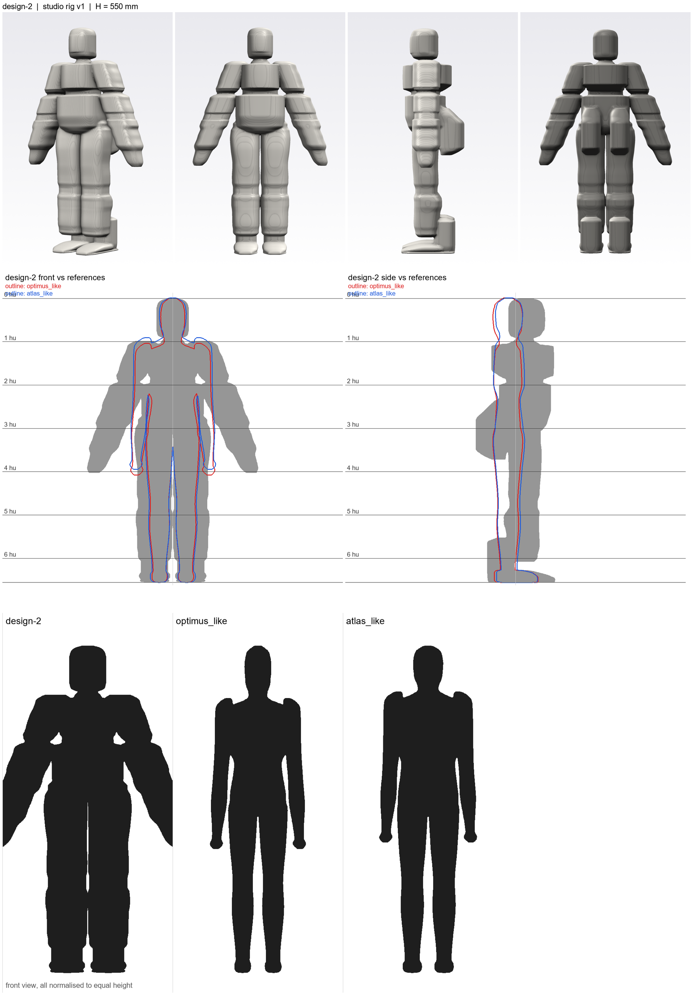
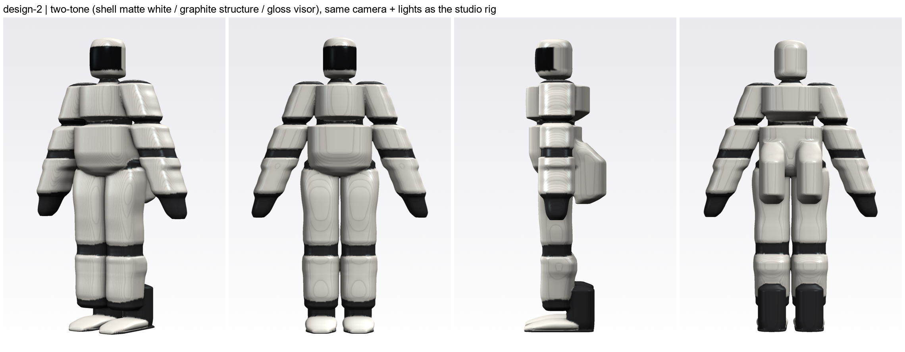

# R2a Silhouette review: Adam (2026-10-19) — PROVISIONAL

**Phase:** design D0–D1 (ADR 0010, `docs/design-method.md`) · **Task:** T-20261019-d955 · **Baseline:** the provisional R1 sign-off (0.55 m, 23 DOF, chest-6dof layout, STS3250 at hip roll and knees, Pi 5, GNB 3S 1850).

**Status: PROVISIONAL.** Signed only under the overnight authority; the maintainer reviews in the morning. Nothing downstream (D2 massing, shells, CAD) should treat this silhouette as approved.

## 0. Read this first

- **Recommendation: direction B, "Atlas-capsule".** File: `variants/adam/design/profiles.yaml`. It is the same as `silhouette/dir_B/profiles.yaml` and the render set `docs/design-method/R2a/B_atlas_capsule/`.
- **Why B.** The blind critic preferred B over the best direction-A iteration in both presentation orders. It then preferred the tapered-leg revision of B (B4) over B3 in both orders.
- **It still reads as a toy.** The critic said "toy" or "unfinished" for every iteration of every direction, in all 14 reports. No gestalt criterion apart from G3 (two-tone) passed. Each silhouette is a big improvement on the R1 minimal massing: preferred in both orders, and S3b and P5 now pass. But it is not an adult product yet.
- **Where the limit is.** The critic's top three changes are the same every round: narrow the shoulders and arms, taper the legs, lengthen the neck. Each is fixed by a hard point, not by the profile. §4 gives the numbers. This repeats the shell bake-off's finding ("the limit is the shared target, not the method").
- **All directions keep every hard point.** Every one passes the framework hard-point check (`HP`). No servo was shrunk.
- **Two R1 hard points were re-expressed, not changed:**
  - the battery is the signed-off GNB 1850, which is larger than R1's 1300;
  - the arm servos are rotated with the arm, where R1 had them sheared.
- **The foot is longer than the look band** because the silhouette keeps the concept engine's validated toe reach (§2).

## 1. Lineup (the maintainer's choice)

| Direction | Idea | Kept from the references | Critic |
|---|---|---|---|
| **B. Atlas-capsule (recommended)** | Near-elliptical sections (n 2.5) with large blends. White chest and pelvis capsules with a graphite waist ring. Round, proud shoulder capsules. Tapered leg covers with a calf swell. A slim graphite upper-arm neck under the shoulder cap. Full-wrap visor. | Atlas: capsule primitives, calm monochrome. Optimus: white over graphite, visor. | Preferred over A10 in both orders. B4 preferred over B3 in both orders. B5 tied, so B4 is kept. |
| A. Optimus-lean | Squircles (n 3). Graphite waist band over a dark pelvis core with a white hip shell. Dark shoulder **side panels**: a cap narrower than its core, a trick to narrow the read. Tapered limb covers. Full-face visor. | Optimus: black waist band, white shells, visor, tapered limbs. | Three rounds, each preferred in both orders (A5 > R1, A9 > A5, A10 > A9). It then lost to B3: the side panels read as "black smears / unfinished masking". |
| C. Apple-monolith | One white unibody torso with a hairline waist reveal. Thigh and shank as one continuous cover with a hairline knee reveal. Horizontal visor band. n 3.2. | Apple: unibody, few radii, minimal seams. | Split decision against A10 (one order each), so G5 uncertain. Hairline joints "read as pipe sections"; the goggle visor reads "more toy". |

Every direction uses the same hard points, the same arm display cant (21°), the same head, neck and foot packaging, and the same graphite under-structure. They differ only in shells and recess treatment, because the hardware leaves little else free (§4).

## 2. D0 brief

**Adjectives:** adult, sleek, calm. The look must not read as a toy (R6).

**References, from `variants/adam/design-language.md` and `openhumanoid/design/references/`.** Both reference profiles are approximate: low confidence, not pixel-measured.

| Reference | Take | Leave |
|---|---|---|
| Tesla Optimus (`optimus_like`, 1.73 m) | Human proportions. White shells over a black under-structure. Glossy faceless visor. Tapered limbs with a slight swell. A black waist/pelvis band. | Complex hands. Exposed rear actuators. |
| Electric Atlas (`atlas_like`, 1.9 m) | Capsule and cylinder primitives with smooth blends. Calm monochrome. One face element. No cables. Compact hips. | Inhuman joint ranges as styling. Industrial grey. |
| Apple ID | Unibody feel. A few consistent radii (3 / 8 mm at Adam scale). One material, one accent. Even 0.8 mm reveals. | Machined tolerances FDM can't hold. |

**Hard points: non-negotiable.** These are boxes with housing included, from `r1_packaging/chest-6dof-550`. Each needs 3.1 mm of wall plus gap (1.5 mm gap, 1.6 mm shell). Source: `variants/adam/design/silhouette/hardpoints.py`.

| Hard point | Box (mm), x fwd / y left / z up | Note |
|---|---|---|
| Joint centres | hip (0, ±35, 275); knee 148.5; ankle 66; shoulder roll axis (0, ±65.15, 439.3); elbow 334.8 | P6 = 0.50 and P7 = 0.27 by construction |
| Hip-pitch, knee, ankle-pitch servos (×2) | x ±15, y 9…61 (52 mm fork), z 260–311 / 134–184 / 51–102 | Sets the leg width at every joint |
| Hip-roll servos, the gimbal envelope (×2) | x −81.7…−41.3, y 20…50, z 260–311 | ~84 mm behind the hip axis (CAD foundation) |
| Hip-yaw ×2 and waist-yaw | x −14.7…35.9, y ±50 (three side by side), z 338–379 | Top of the gimbal stack, ~106 mm above the hip |
| Pi 5 + buck + IMU bay | x −37…−14.7, y ±45.2, z 313–374 | |
| **3S pack, GNB 1850** (R1 sign-off) | x −49.3…−15, y ±40.2, z 415–454 | Re-derived with the R1 rule. 7 mm deeper and 3 mm wider than R1's 1300 box. |
| Shoulder-pitch servos (back to back) | x ±15, y ±38.7, z 403–454 | Their top sets the chest top at 457 mm |
| Neck-yaw servo (front slot) | x 15…45, y ±25.3, z 414–454 | |
| Ankle-roll servo (6-DOF) | x −64.2…−23.8, y 20…50, z 23–74 | Ankle height 66 mm |
| Arm: shoulder-roll, elbow, gripper servos | R1 sizes. The centres follow R1's rule on the canted arm line, and each box is **rotated** with the arm. | See below |
| Neck-pitch servo + camera (head) | x ±15, y ±21.2, z 482–532; camera x 16…27.5 | Sets head width ≥ 54 mm and the chin height |

Two re-expressions, both stated plainly:

1. **Pack.** R1 drew the Tattu 1300. The signed-off pack is the GNB 1850 (75 × 29 × 34 mm), so its keep-out is larger.
2. **Arm boxes.** `r1_packaging.py` moves the arm servos onto the canted line but keeps them axis-aligned (a shear). A sheared box needs about 6 mm more arm width per side than the servo it stands for.
   - Each servo is now rotated by the cant about its R1 centre.
   - Because the schema only has axis-aligned boxes, each rotated servo is written as 12 horizontal slices whose union contains it.
   - Sizes are unchanged and the result is conservative.
   - Tool gap: `schemas/design-profiles.schema.json` has no rotated boxes (frozen interface, so not touched).

**Arm display cant: 21°**, against R1's minimum of 13.8°.

- R1's cant gives 1 mm of clearance between box-shaped shells.
- With rounded sections, 16–18° makes the elbow touch the pelvis in the front view, so the arms read as glued to the body. In an early 16° iteration the merged arms also made P5 fail (1.23).
- 21° is the smallest cant that keeps a visible gap. It is a pose choice, not hardware.

**Foot: 129 mm (0.238 H)**, from the heel at −68 to the toe at +61 relative to the ankle. Two constraints set it:

- **Toe.** The concept engine centres the sole 0.15 L ahead of the ankle. R1 validated R10 at L = 0.17 H, so the sole must reach +61 mm.
- **Heel.** The ankle-roll servo housing sets the heel at −68.

An early iteration had the toe at +46, which silently shortened the engine's foot. It was caught and fixed; see the LESSONS row. The visual trick is a white shoe shell from −40 to +61, about 0.18 H, on a graphite sole with a graphite heel.

## 3. Recommended direction B: studio sheet, two-tone, hard points

`oh render adam --studio` equivalent: `python -m openhumanoid.design render adam`. Its output is `variants/adam/generated/renders/studio/`, and the metrics are in `variants/adam/generated/design_metrics.json`.

The clay rig is single-colour. `silhouette/render.py` adds a two-tone view with the same camera and lights, coloured by segment role, so G3 can be judged at all.

Contour "wood-grain" lines on the clay are marching-cubes terracing of the massing (1.5 mm voxels), not design.

## 4. Metrics (code-measured; `oh design metrics`)

| id | band | gate | R1 massing | **B (rec.)** | A | C |
|---|---|---|---|---|---|---|
| P1 head / H | 0.11–0.15 | hard | 0.134 | 0.136 | 0.136 | 0.136 |
| P2a neck / hu | 0.18–0.55 | soft | 0.104 ✗ | 0.110 ✗ | 0.118 ✗ | 0.132 ✗ |
| P2b neck / head width | ≥ 0.50 | hard | 0.820 | 0.561 | 0.544 | 0.553 |
| **P3 shoulder / H** | 0.22–0.29 | hard | 0.399 ✗ | **0.397 ✗** | 0.389 ✗ | 0.422 ✗ |
| P4 waist / shoulder | 0.50–0.75 | hard | 0.632 | 0.549 | 0.550 | 0.502 |
| P5 pelvis / shoulder | 0.62–0.90 | soft | 1.178 ✗ | 0.675 | 0.689 | 0.626 |
| P6 hip / H | 0.46–0.53 | hard | 0.500 | 0.500 | 0.500 | 0.500 |
| P7 knee / H | 0.25–0.30 | hard | 0.270 | 0.270 | 0.270 | 0.270 |
| P8a thigh taper | ≤ 0.65 | soft | n/a | 0.860 ✗ | 0.865 ✗ | 0.963 ✗ |
| P8b shank taper | ≤ 0.60 | soft | n/a | 0.938 ✗ | 0.913 ✗ | 0.924 ✗ |
| P9a / P9b widest point | ≤ 0.33 | soft | 0.00 / 0.26 | 0.02 / 0.15 | 0.01 / 0.45 ✗ | 0.00 / 0.08 |
| **P10a foot / H** | 0.13–0.17 | hard | 0.208 ✗ | **0.238 ✗** | 0.238 ✗ | 0.238 ✗ |
| P10b foot height / H | ≤ 0.05 | hard | 0.034 | 0.032 | 0.032 | 0.032 |
| S3a ledges | ≤ 6 | hard | 6 | 4 | 4 | 3 |
| S3b leg bumps | ≤ 3 | soft | 5 ✗ | 3 | 3 | 2 |
| S4a flat share | ≤ 0.30 | hard | 0.250 | 0.129 | 0.132 | 0.201 |
| S4b worst flat part | ≤ 0.30 | soft | 0.192 | 0.514 ✗ | 0.647 ✗ | 0.619 ✗ |
| HP hard points | all | hard | pass | **pass** | pass | pass |
| passed | | | 12/17 | **13/19** | 12/19 | 13/19 |
| S2 IoU vs optimus / atlas | info | | 0.57 / 0.60 | 0.53 / 0.56 | 0.53 / 0.56 | 0.53 / 0.56 |

**Hard-gate failures and why.**

- **P3 is out of reach with this hardware.** The P3 band is the widest row from the neck base down 0.14 H.
  - The shoulder-roll servo sits in the shoulder cap. Rotated, with housing, wall and gap, its outer edge alone gives a **hardware floor of 0.347 H at a 21° cant** (0.333 H at the R1 cant of 13.8°). The band top is 0.29 H, so the hardware floor alone is ~31 mm (0.057 H) over before any surface.
  - The rest of the measured 0.397 H is the proud cap shell and the canted upper arm at the bottom of the band. Direction A's dark side panel (cap narrower than its core) and slim upper arm get to 0.389.
  - This confirms challenge-3 row 14 and R1 §5: STS-class servos cannot reach the band at 0.40–0.65 m. Only a hardware move changes the floor: the lateral-face elbow plus a forward arm offset (R1 table: 0.318 at 0.60 m), or a smaller shoulder-roll servo.
  - P3 also drives the P4 artefact. P4 compares the hip shell with an elbow-inflated P3, so the hip shell has to stay at least 0.5 × P3 wide. B and C carry 2–3 mm of extra hip-shell width for that reason, and it is not a look choice.
- **P10a: 6-DOF heel plus the engine's toe reach (§2).** 5-DOF legs (no ankle-roll servo, R1 §4.3) would pass P10a. That is a hardware question.

**Soft failures and why.**

- **P2a.** The shoulder-servo housings fix the chest top at 457 mm. The standing neck-pitch servo fixes a full-width head section at 478.5 mm. That leaves at most ~13 mm of neck to show.
- **P8a / P8b.** The 52 mm forks make every leg joint the same width (core 63 mm), so the front view cannot taper. Taper only lives in depth (quad forward, calf behind) and between forks.
- **S4b.** The worst part is the flat graphite **sole** (0.51), which is ground contact by necessity, not a styling choice.

## 5. Critic verdicts (blind, Sonnet `design-critic`, both orders; raw JSON in `docs/design-method/R2a/critic/`)

Combined with `oh design verdict`: UNCERTAIN counts as a no-pass, a preference counts only if it wins in both orders, and there is a 3-round cap.

| Step / round | Candidate vs baseline | cand_first | cand_second | G5 | G1 | G2 | G3 | G4 | G6 | reads_as |
|---|---|---|---|---|---|---|---|---|---|---|
| A r1 | A5 vs R1 massing | cand | cand | **PASS** | F | F | PASS | PASS | F | toy / toy |
| A r2 | A9 vs A5 | cand | cand | **PASS** | F | F | UNC | F | F | toy / toy |
| A r3 (cap) | A10 vs A9 | cand | cand* | **PASS** | F | F | PASS | F | F | toy / toy |
| Direction r1 | B3 vs A10 | cand | cand | **PASS** | F | F | PASS | F | F | toy / toy |
| Direction r1 | C3 vs A10 | cand | **base** | UNC | F | F | UNC | F | F | toy / toy |
| B r2 | B4 vs B3 | cand | cand | **PASS** | F | F | PASS | UNC | F | toy / toy |
| B r3 (cap) | B5 vs B4 | tie | tie | UNC | F | F | PASS | F | F | toy / unfinished |

\* That cand_second report quoted the baseline's metric values as the candidate's. It is recorded as returned (see `author_note`) and treated as low-confidence.

**How the verdicts were used.**

- With the cap reached, the protocol keeps the best-so-far, which is **B4**. B5's changes (rounder head, thinner neck, tapered pelvis bottom) were reverted. The method says to escalate to the human, and this review is that escalation.
- **A11 is not critic-judged.** It is A10 plus a slimmer upper arm, applied after A's cap and taken from the critic's own top change. The lineup shows A11. A11's two-tone still has the dark shoulder side panels the critic disliked.

**What the critic kept asking for, and whether it can be done:**

| Top change (every round) | Feasible in D1? |
|---|---|
| Narrow the shoulders and arms to 0.22–0.29 H, arms closer to vertical | **No.** Shoulder-roll servo floor 0.347 H. The cant is the minimum for a visible pelvis gap (§2, §4). |
| Taper thigh and shank | **Partly.** Done in depth and between the forks. The front width is fixed by 52 mm forks at hip, knee and ankle. |
| Longer neck, rounder head | **Partly.** About 2 mm gained. The neck-pitch servo standing in the head fixes the head width (62 mm) and the chin. A round-head try (n 2.0) **broke the hard-point margin** and was rejected. |
| Shorter foot | **No**, not without dropping the engine's validated toe reach or the ankle-roll servo. |
| Chest, waist and pelvis as one flowing form; no slab back pack | **Partly.** Torso blend radius raised by 4 mm (to 12–14 mm), with rolled chest and back ends. The GNB 1850 behind the shoulder servos makes the chest 120 mm deep. |

## 6. What the shells will add (D2–D5, bake-off method M3)

- **What M3 brings.**
  - Blender `bpy` subdivision cover shells, made from these profiles with uniform 1.6 mm walls. In the bake-off M3 had the best silhouette fidelity (IoU 0.989), was deterministic and fit the bed, and won the blind critic in both orders.
  - It removes what the massing can't show:
    - the marching-cube terracing;
    - real 2–3 mm **recessed** joint bands (here they are colour on near-coplanar cores);
    - 0.8 mm reveals and one seam per segment;
    - a separate glossy visor part;
    - G2-continuous blends (zebra-checkable).
  - This should lift G3/G4 and the "unfinished" read.
- **What M3 won't change.** The bake-off rated **all three methods "unfinished"**, because the limit was the target. Shells do not change the silhouette (S1 ≥ 0.95 is enforced against this D1). So P3, P10a, the leg columns and the head size stay what this sheet shows.
- **Open contract item, from the bake-off.** M3 shells are mesh-only, so shipping them needs the ADR that lets cosmetic FDM parts be mesh-only. It touches `cad/EXPORT_CONTRACT.md` and is queued for the maintainer.

## 7. Honest limits (what still reads unfinished)

- **Top-heavy, wide shoulders and arms in an A-pose.**
  - Shoulder-roll servo in the cap.
  - Elbow servo 42 mm across, in the P3 band.
  - 21° cant to clear a 120 mm pelvis (three yaw servos side by side).
- **Column legs**, from the 52 mm forks at every joint (above).
- **Boxy, wide head.** The standing neck-pitch servo (42.3 mm housing) sets 62 mm of width at 0.14 H height. The critic calls it a "rounded cube".
- **Deep chest and a back-pack bulge in side view.** The pack sits behind the shoulder servos, and the neck-yaw servo is in front.
- **Long foot and heavy black heel.** 6-DOF ankle roll plus the engine's toe reach.
- **Massing artefacts.**
  - Terracing.
  - Small graphite "dots" where a core corner touches a cover. These were mostly fixed by keeping cores no squarer than covers.
  - The framework lineup crops the A-pose hand tips (`studio.lineup_image` crop width; not changed, framework).
- **Critic noise.** Single runs per order. One report swapped candidate and baseline metrics. The critic has not been calibrated against the maintainer (method §6 limits).

## 8. Maintainer questions (≤ 3)

1. **Direction.** Approve **B Atlas-capsule** (B4) as the D2 baseline? The alternatives are A (Optimus waist band and side panels) and C (monolith). Rating the lineup yourself would also calibrate the critic, which has never been checked against you.
2. **Accept or move the hardware limits?** Accept P3 (≈0.40), P10a (0.24), P2a and the column legs as Adam's hardware-driven reading (relax those bands for Adam, R1 Q2)? Or spend packaging moves before D2? The moves that change the silhouette most:
   - (a) lateral-face elbow plus a forward arm offset: R1's packaging table gives 0.399 → 0.348 at 0.55 m, with a right-angle stage not in the catalog;
   - (b) 5-DOF legs: P10a passes, foot about −35 mm; engine re-test needed;
   - (c) the pack moved low into the pelvis or down the back: slimmer chest;
   - (d) 0.60 m height: about −0.035 H on P3, bench-gated.
3. **Arm display cant 21°** (A-pose, needed for a visible arm-to-pelvis gap with rounded shells): acceptable for review renders? Or show arms at R1's 13.8° touching the hips?

## Evidence index

- **Profiles:**
  - `variants/adam/design/profiles.yaml` (recommended, B);
  - `variants/adam/design/silhouette/dir_{A,B,C}/profiles.yaml`.
- **Tools** (variant-local; no framework edits):
  - `variants/adam/design/silhouette/hardpoints.py` (R2a hard points);
  - `build.py` (fit-to-hard-point stations, profile writer, HP check);
  - `directions.py` (station tables; run it to regenerate);
  - `render.py` (studio rig, metrics, two-tone, hard-point overlay);
  - `lineup.py`.
- **Renders:**
  - `docs/design-method/R2a/{B_atlas_capsule,A_optimus_lean,C_apple_monolith}/` (full sets);
  - `docs/design-method/R2a/work/` (critic-round sheets: R1base, A5, A9, A10, B3, B5);
  - `docs/design-method/R2a/lineup.png`.
- **Critic:** `docs/design-method/R2a/critic/*.json` (raw reports, abridged where marked) and `verdict_*.json` (combined).
- **Reproduce:**
  - `.venv/Scripts/python variants/adam/design/silhouette/directions.py`
  - `.venv/Scripts/python variants/adam/design/silhouette/render.py variants/adam/design/profiles.yaml B_atlas_capsule --label design-2`

---
## Commander sign-off
*(left for the commander: PROVISIONAL R2a under the overnight authority; maintainer to confirm direction and the hardware-limit questions in the morning.)*
