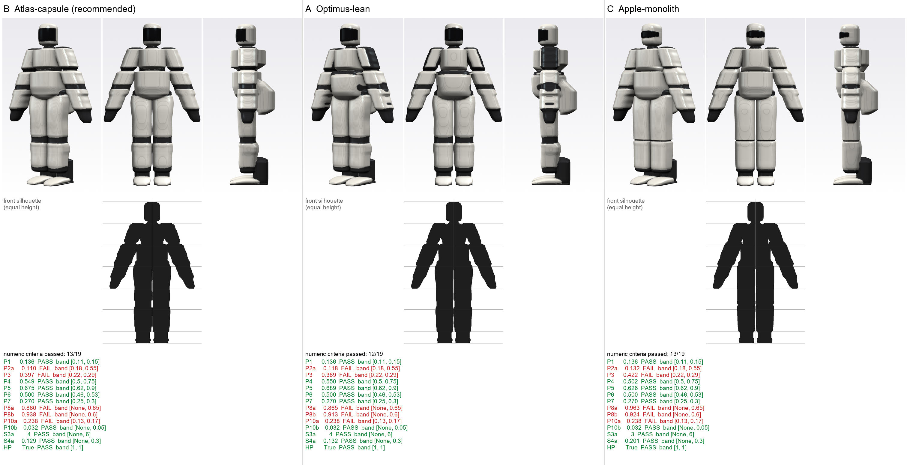
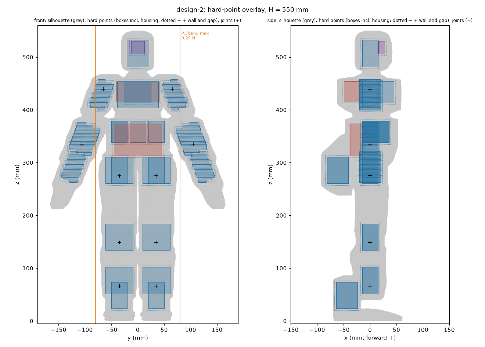
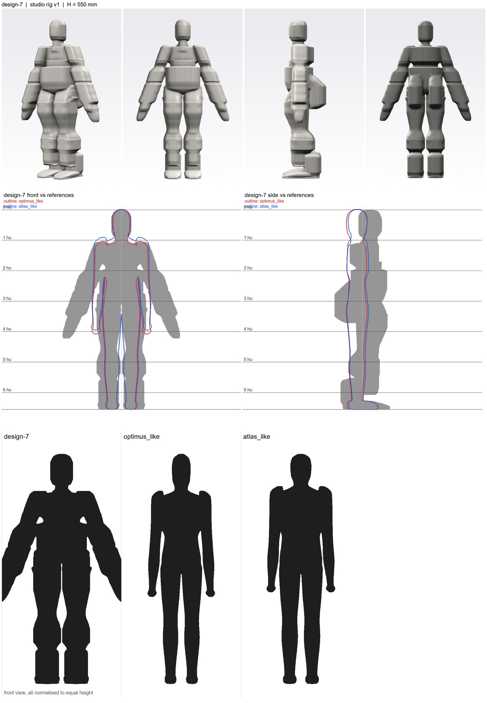
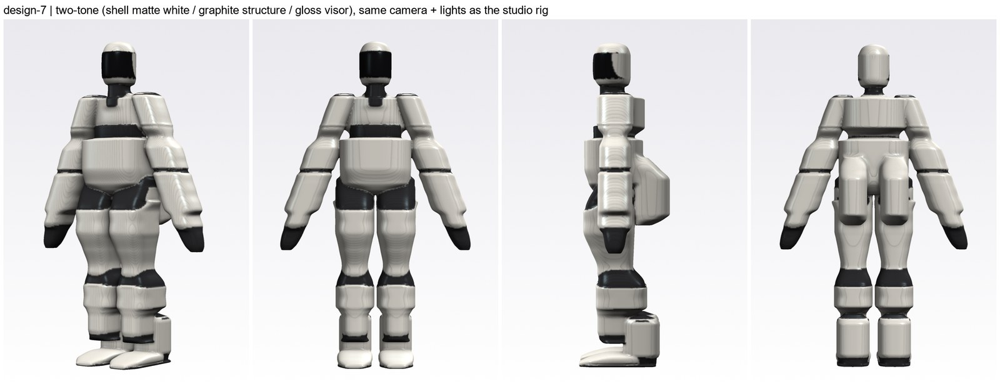

# R2a Silhouette review: Adam (2026-10-19) — PROVISIONAL

**Phase:** design D0–D1 (ADR 0010, `docs/design-method.md`) · **Task:** T-20261019-d955 · **Baseline:** the provisional R1 sign-off (0.55 m, 23 DOF, chest-6dof layout, STS3250 at hip roll and knees, Pi 5, GNB 3S 1850).

**Status: PROVISIONAL.** Signed only under the overnight authority; the maintainer reviews in the morning. Nothing downstream (D2 massing, shells, CAD) should treat this silhouette as approved.

## 0. Read this first

- **Recommendation: direction B, "Atlas-capsule".** File: `variants/adam/design/profiles.yaml`. It is the same as `silhouette/dir_B/profiles.yaml` and the render set `docs/design-method/R2a/B_atlas_capsule/`.
- **Why B.** The blind critic preferred B over the best direction-A iteration in both presentation orders. It then preferred the tapered-leg revision of B (B4) over B3 in both orders.
- **It still reads as a toy.** The critic said "toy" or "unfinished" for every iteration of every direction, in all 14 reports. No gestalt criterion apart from G3 (two-tone) passed. Each silhouette is a big improvement on the R1 minimal massing: preferred in both orders, and S3b and P5 now pass. But it is not an adult product yet.
- **Where the limit is.** The critic's top three changes are the same every round: narrow the shoulders and arms, taper the legs, lengthen the neck. Each is fixed by a hard point, not by the profile. §4 gives the numbers. This repeats the shell bake-off's finding ("the limit is the shared target, not the method").
- **All directions keep every hard point.** Every one passes the framework hard-point check (`HP`). No servo was shrunk.
- **Two R1 hard points were re-expressed, not changed:**
  - the battery is the signed-off GNB 1850, which is larger than R1's 1300;
  - the arm servos are rotated with the arm, where R1 had them sheared.
- **The foot is longer than the look band** because the silhouette keeps the concept engine's validated toe reach (§2).

## 1. Lineup (the maintainer's choice)

| Direction | Idea | Kept from the references | Critic |
|---|---|---|---|
| **B. Atlas-capsule (recommended)** | Near-elliptical sections (n 2.5) with large blends. White chest and pelvis capsules with a graphite waist ring. Round, proud shoulder capsules. Tapered leg covers with a calf swell. A slim graphite upper-arm neck under the shoulder cap. Full-wrap visor. | Atlas: capsule primitives, calm monochrome. Optimus: white over graphite, visor. | Preferred over A10 in both orders. B4 preferred over B3 in both orders. B5 tied, so B4 is kept. |
| A. Optimus-lean | Squircles (n 3). Graphite waist band over a dark pelvis core with a white hip shell. Dark shoulder **side panels**: a cap narrower than its core, a trick to narrow the read. Tapered limb covers. Full-face visor. | Optimus: black waist band, white shells, visor, tapered limbs. | Three rounds, each preferred in both orders (A5 > R1, A9 > A5, A10 > A9). It then lost to B3: the side panels read as "black smears / unfinished masking". |
| C. Apple-monolith | One white unibody torso with a hairline waist reveal. Thigh and shank as one continuous cover with a hairline knee reveal. Horizontal visor band. n 3.2. | Apple: unibody, few radii, minimal seams. | Split decision against A10 (one order each), so G5 uncertain. Hairline joints "read as pipe sections"; the goggle visor reads "more toy". |

Every direction uses the same hard points, the same arm display cant (21°), the same head, neck and foot packaging, and the same graphite under-structure. They differ only in shells and recess treatment, because the hardware leaves little else free (§4).

## 2. D0 brief

**Adjectives:** adult, sleek, calm. The look must not read as a toy (R6).

**References, from `variants/adam/design-language.md` and `openhumanoid/design/references/`.** Both reference profiles are approximate: low confidence, not pixel-measured.

| Reference | Take | Leave |
|---|---|---|
| Tesla Optimus (`optimus_like`, 1.73 m) | Human proportions. White shells over a black under-structure. Glossy faceless visor. Tapered limbs with a slight swell. A black waist/pelvis band. | Complex hands. Exposed rear actuators. |
| Electric Atlas (`atlas_like`, 1.9 m) | Capsule and cylinder primitives with smooth blends. Calm monochrome. One face element. No cables. Compact hips. | Inhuman joint ranges as styling. Industrial grey. |
| Apple ID | Unibody feel. A few consistent radii (3 / 8 mm at Adam scale). One material, one accent. Even 0.8 mm reveals. | Machined tolerances FDM can't hold. |

**Hard points: non-negotiable.** These are boxes with housing included, from `r1_packaging/chest-6dof-550`. Each needs 3.1 mm of wall plus gap (1.5 mm gap, 1.6 mm shell). Source: `variants/adam/design/silhouette/hardpoints.py`.

| Hard point | Box (mm), x fwd / y left / z up | Note |
|---|---|---|
| Joint centres | hip (0, ±35, 275); knee 148.5; ankle 66; shoulder roll axis (0, ±65.15, 439.3); elbow 334.8 | P6 = 0.50 and P7 = 0.27 by construction |
| Hip-pitch, knee, ankle-pitch servos (×2) | x ±15, y 9…61 (52 mm fork), z 260–311 / 134–184 / 51–102 | Sets the leg width at every joint |
| Hip-roll servos, the gimbal envelope (×2) | x −81.7…−41.3, y 20…50, z 260–311 | ~84 mm behind the hip axis (CAD foundation) |
| Hip-yaw ×2 and waist-yaw | x −14.7…35.9, y ±50 (three side by side), z 338–379 | Top of the gimbal stack, ~106 mm above the hip |
| Pi 5 + buck + IMU bay | x −37…−14.7, y ±45.2, z 313–374 | |
| **3S pack, GNB 1850** (R1 sign-off) | x −49.3…−15, y ±40.2, z 415–454 | Re-derived with the R1 rule. 7 mm deeper and 3 mm wider than R1's 1300 box. |
| Shoulder-pitch servos (back to back) | x ±15, y ±38.7, z 403–454 | Their top sets the chest top at 457 mm |
| Neck-yaw servo (front slot) | x 15…45, y ±25.3, z 414–454 | |
| Ankle-roll servo (6-DOF) | x −64.2…−23.8, y 20…50, z 23–74 | Ankle height 66 mm |
| Arm: shoulder-roll, elbow, gripper servos | R1 sizes. The centres follow R1's rule on the canted arm line, and each box is **rotated** with the arm. | See below |
| Neck-pitch servo + camera (head) | x ±15, y ±21.2, z 482–532; camera x 16…27.5 | Sets head width ≥ 54 mm and the chin height |

Two re-expressions, both stated plainly:

1. **Pack.** R1 drew the Tattu 1300. The signed-off pack is the GNB 1850 (75 × 29 × 34 mm), so its keep-out is larger.
2. **Arm boxes.** `r1_packaging.py` moves the arm servos onto the canted line but keeps them axis-aligned (a shear). A sheared box needs about 6 mm more arm width per side than the servo it stands for.
   - Each servo is now rotated by the cant about its R1 centre.
   - Because the schema only has axis-aligned boxes, each rotated servo is written as 12 horizontal slices whose union contains it.
   - Sizes are unchanged and the result is conservative.
   - Tool gap: `schemas/design-profiles.schema.json` has no rotated boxes (frozen interface, so not touched).

**Arm display cant: 21°**, against R1's minimum of 13.8°.

- R1's cant gives 1 mm of clearance between box-shaped shells.
- With rounded sections, 16–18° makes the elbow touch the pelvis in the front view, so the arms read as glued to the body. In an early 16° iteration the merged arms also made P5 fail (1.23).
- 21° is the smallest cant that keeps a visible gap. It is a pose choice, not hardware.

**Foot: 129 mm (0.238 H)**, from the heel at −68 to the toe at +61 relative to the ankle. Two constraints set it:

- **Toe.** The concept engine centres the sole 0.15 L ahead of the ankle. R1 validated R10 at L = 0.17 H, so the sole must reach +61 mm.
- **Heel.** The ankle-roll servo housing sets the heel at −68.

An early iteration had the toe at +46, which silently shortened the engine's foot. It was caught and fixed; see the LESSONS row. The visual trick is a white shoe shell from −40 to +61, about 0.18 H, on a graphite sole with a graphite heel.

## 3. Recommended direction B: studio sheet, two-tone, hard points

`oh render adam --studio` equivalent: `python -m openhumanoid.design render adam`. Its output is `variants/adam/generated/renders/studio/`, and the metrics are in `variants/adam/generated/design_metrics.json`.

The clay rig is single-colour. `silhouette/render.py` adds a two-tone view with the same camera and lights, coloured by segment role, so G3 can be judged at all.

Contour "wood-grain" lines on the clay are marching-cubes terracing of the massing (1.5 mm voxels), not design.

## 4. Metrics (code-measured; `oh design metrics`)

| id | band | gate | R1 massing | **B (rec.)** | A | C |
|---|---|---|---|---|---|---|
| P1 head / H | 0.11–0.15 | hard | 0.134 | 0.136 | 0.136 | 0.136 |
| P2a neck / hu | 0.18–0.55 | soft | 0.104 ✗ | 0.110 ✗ | 0.118 ✗ | 0.132 ✗ |
| P2b neck / head width | ≥ 0.50 | hard | 0.820 | 0.561 | 0.544 | 0.553 |
| **P3 shoulder / H** | 0.22–0.29 | hard | 0.399 ✗ | **0.397 ✗** | 0.389 ✗ | 0.422 ✗ |
| P4 waist / shoulder | 0.50–0.75 | hard | 0.632 | 0.549 | 0.550 | 0.502 |
| P5 pelvis / shoulder | 0.62–0.90 | soft | 1.178 ✗ | 0.675 | 0.689 | 0.626 |
| P6 hip / H | 0.46–0.53 | hard | 0.500 | 0.500 | 0.500 | 0.500 |
| P7 knee / H | 0.25–0.30 | hard | 0.270 | 0.270 | 0.270 | 0.270 |
| P8a thigh taper | ≤ 0.65 | soft | n/a | 0.860 ✗ | 0.865 ✗ | 0.963 ✗ |
| P8b shank taper | ≤ 0.60 | soft | n/a | 0.938 ✗ | 0.913 ✗ | 0.924 ✗ |
| P9a / P9b widest point | ≤ 0.33 | soft | 0.00 / 0.26 | 0.02 / 0.15 | 0.01 / 0.45 ✗ | 0.00 / 0.08 |
| **P10a foot / H** | 0.13–0.17 | hard | 0.208 ✗ | **0.238 ✗** | 0.238 ✗ | 0.238 ✗ |
| P10b foot height / H | ≤ 0.05 | hard | 0.034 | 0.032 | 0.032 | 0.032 |
| S3a ledges | ≤ 6 | hard | 6 | 4 | 4 | 3 |
| S3b leg bumps | ≤ 3 | soft | 5 ✗ | 3 | 3 | 2 |
| S4a flat share | ≤ 0.30 | hard | 0.250 | 0.129 | 0.132 | 0.201 |
| S4b worst flat part | ≤ 0.30 | soft | 0.192 | 0.514 ✗ | 0.647 ✗ | 0.619 ✗ |
| HP hard points | all | hard | pass | **pass** | pass | pass |
| passed | | | 12/17 | **13/19** | 12/19 | 13/19 |
| S2 IoU vs optimus / atlas | info | | 0.57 / 0.60 | 0.53 / 0.56 | 0.53 / 0.56 | 0.53 / 0.56 |

**Hard-gate failures and why.**

- **P3 is out of reach with this hardware.** The P3 band is the widest row from the neck base down 0.14 H.
  - The shoulder-roll servo sits in the shoulder cap. Rotated, with housing, wall and gap, its outer edge alone gives a **hardware floor of 0.347 H at a 21° cant** (0.333 H at the R1 cant of 13.8°). The band top is 0.29 H, so the hardware floor alone is ~31 mm (0.057 H) over before any surface.
  - The rest of the measured 0.397 H is the proud cap shell and the canted upper arm at the bottom of the band. Direction A's dark side panel (cap narrower than its core) and slim upper arm get to 0.389.
  - This confirms challenge-3 row 14 and R1 §5: STS-class servos cannot reach the band at 0.40–0.65 m. Only a hardware move changes the floor: the lateral-face elbow plus a forward arm offset (R1 table: 0.318 at 0.60 m), or a smaller shoulder-roll servo.
  - P3 also drives the P4 artefact. P4 compares the hip shell with an elbow-inflated P3, so the hip shell has to stay at least 0.5 × P3 wide. B and C carry 2–3 mm of extra hip-shell width for that reason, and it is not a look choice.
- **P10a: 6-DOF heel plus the engine's toe reach (§2).** 5-DOF legs (no ankle-roll servo, R1 §4.3) would pass P10a. That is a hardware question.

**Soft failures and why.**

- **P2a.** The shoulder-servo housings fix the chest top at 457 mm. The standing neck-pitch servo fixes a full-width head section at 478.5 mm. That leaves at most ~13 mm of neck to show.
- **P8a / P8b.** The 52 mm forks make every leg joint the same width (core 63 mm), so the front view cannot taper. Taper only lives in depth (quad forward, calf behind) and between forks.
- **S4b.** The worst part is the flat graphite **sole** (0.51), which is ground contact by necessity, not a styling choice.

## 5. Critic verdicts (blind, Sonnet `design-critic`, both orders; raw JSON in `docs/design-method/R2a/critic/`)

Combined with `oh design verdict`: UNCERTAIN counts as a no-pass, a preference counts only if it wins in both orders, and there is a 3-round cap.

| Step / round | Candidate vs baseline | cand_first | cand_second | G5 | G1 | G2 | G3 | G4 | G6 | reads_as |
|---|---|---|---|---|---|---|---|---|---|---|
| A r1 | A5 vs R1 massing | cand | cand | **PASS** | F | F | PASS | PASS | F | toy / toy |
| A r2 | A9 vs A5 | cand | cand | **PASS** | F | F | UNC | F | F | toy / toy |
| A r3 (cap) | A10 vs A9 | cand | cand* | **PASS** | F | F | PASS | F | F | toy / toy |
| Direction r1 | B3 vs A10 | cand | cand | **PASS** | F | F | PASS | F | F | toy / toy |
| Direction r1 | C3 vs A10 | cand | **base** | UNC | F | F | UNC | F | F | toy / toy |
| B r2 | B4 vs B3 | cand | cand | **PASS** | F | F | PASS | UNC | F | toy / toy |
| B r3 (cap) | B5 vs B4 | tie | tie | UNC | F | F | PASS | F | F | toy / unfinished |

\* That cand_second report quoted the baseline's metric values as the candidate's. It is recorded as returned (see `author_note`) and treated as low-confidence.

**How the verdicts were used.**

- With the cap reached, the protocol keeps the best-so-far, which is **B4**. B5's changes (rounder head, thinner neck, tapered pelvis bottom) were reverted. The method says to escalate to the human, and this review is that escalation.
- **A11 is not critic-judged.** It is A10 plus a slimmer upper arm, applied after A's cap and taken from the critic's own top change. The lineup shows A11. A11's two-tone still has the dark shoulder side panels the critic disliked.

**What the critic kept asking for, and whether it can be done:**

| Top change (every round) | Feasible in D1? |
|---|---|
| Narrow the shoulders and arms to 0.22–0.29 H, arms closer to vertical | **No.** Shoulder-roll servo floor 0.347 H. The cant is the minimum for a visible pelvis gap (§2, §4). |
| Taper thigh and shank | **Partly.** Done in depth and between the forks. The front width is fixed by 52 mm forks at hip, knee and ankle. |
| Longer neck, rounder head | **Partly.** About 2 mm gained. The neck-pitch servo standing in the head fixes the head width (62 mm) and the chin. A round-head try (n 2.0) **broke the hard-point margin** and was rejected. |
| Shorter foot | **No**, not without dropping the engine's validated toe reach or the ankle-roll servo. |
| Chest, waist and pelvis as one flowing form; no slab back pack | **Partly.** Torso blend radius raised by 4 mm (to 12–14 mm), with rolled chest and back ends. The GNB 1850 behind the shoulder servos makes the chest 120 mm deep. |

## 6. What the shells will add (D2–D5, bake-off method M3)

- **What M3 brings.**
  - Blender `bpy` subdivision cover shells, made from these profiles with uniform 1.6 mm walls. In the bake-off M3 had the best silhouette fidelity (IoU 0.989), was deterministic and fit the bed, and won the blind critic in both orders.
  - It removes what the massing can't show:
    - the marching-cube terracing;
    - real 2–3 mm **recessed** joint bands (here they are colour on near-coplanar cores);
    - 0.8 mm reveals and one seam per segment;
    - a separate glossy visor part;
    - G2-continuous blends (zebra-checkable).
  - This should lift G3/G4 and the "unfinished" read.
- **What M3 won't change.** The bake-off rated **all three methods "unfinished"**, because the limit was the target. Shells do not change the silhouette (S1 ≥ 0.95 is enforced against this D1). So P3, P10a, the leg columns and the head size stay what this sheet shows.
- **Open contract item, from the bake-off.** M3 shells are mesh-only, so shipping them needs the ADR that lets cosmetic FDM parts be mesh-only. It touches `cad/EXPORT_CONTRACT.md` and is queued for the maintainer.

## 7. Honest limits (what still reads unfinished)

- **Top-heavy, wide shoulders and arms in an A-pose.**
  - Shoulder-roll servo in the cap.
  - Elbow servo 42 mm across, in the P3 band.
  - 21° cant to clear a 120 mm pelvis (three yaw servos side by side).
- **Column legs**, from the 52 mm forks at every joint (above).
- **Boxy, wide head.** The standing neck-pitch servo (42.3 mm housing) sets 62 mm of width at 0.14 H height. The critic calls it a "rounded cube".
- **Deep chest and a back-pack bulge in side view.** The pack sits behind the shoulder servos, and the neck-yaw servo is in front.
- **Long foot and heavy black heel.** 6-DOF ankle roll plus the engine's toe reach.
- **Massing artefacts.**
  - Terracing.
  - Small graphite "dots" where a core corner touches a cover. These were mostly fixed by keeping cores no squarer than covers.
  - The framework lineup crops the A-pose hand tips (`studio.lineup_image` crop width; not changed, framework).
- **Critic noise.** Single runs per order. One report swapped candidate and baseline metrics. The critic has not been calibrated against the maintainer (method §6 limits).

## 8. Maintainer questions (≤ 3)

1. **Direction.** Approve **B Atlas-capsule** (B4) as the D2 baseline? The alternatives are A (Optimus waist band and side panels) and C (monolith). Rating the lineup yourself would also calibrate the critic, which has never been checked against you.
2. **Accept or move the hardware limits?** Accept P3 (≈0.40), P10a (0.24), P2a and the column legs as Adam's hardware-driven reading (relax those bands for Adam, R1 Q2)? Or spend packaging moves before D2? The moves that change the silhouette most:
   - (a) lateral-face elbow plus a forward arm offset: R1's packaging table gives 0.399 → 0.348 at 0.55 m, with a right-angle stage not in the catalog;
   - (b) 5-DOF legs: P10a passes, foot about −35 mm; engine re-test needed;
   - (c) the pack moved low into the pelvis or down the back: slimmer chest;
   - (d) 0.60 m height: about −0.035 H on P3, bench-gated.
3. **Arm display cant 21°** (A-pose, needed for a visible arm-to-pelvis gap with rounded shells): acceptable for review renders? Or show arms at R1's 13.8° touching the hips?

## Evidence index

- **Profiles:**
  - `variants/adam/design/profiles.yaml` (recommended, B);
  - `variants/adam/design/silhouette/dir_{A,B,C}/profiles.yaml`.
- **Tools** (variant-local; no framework edits):
  - `variants/adam/design/silhouette/hardpoints.py` (R2a hard points);
  - `build.py` (fit-to-hard-point stations, profile writer, HP check);
  - `directions.py` (station tables; run it to regenerate);
  - `render.py` (studio rig, metrics, two-tone, hard-point overlay);
  - `lineup.py`.
- **Renders:**
  - `docs/design-method/R2a/{B_atlas_capsule,A_optimus_lean,C_apple_monolith}/` (full sets);
  - `docs/design-method/R2a/work/` (critic-round sheets: R1base, A5, A9, A10, B3, B5);
  - `docs/design-method/R2a/lineup.png`.
- **Critic:** `docs/design-method/R2a/critic/*.json` (raw reports, abridged where marked) and `verdict_*.json` (combined).
- **Reproduce:**
  - `.venv/Scripts/python variants/adam/design/silhouette/directions.py`
  - `.venv/Scripts/python variants/adam/design/silhouette/render.py variants/adam/design/profiles.yaml B_atlas_capsule --label design-2`

---
## Commander sign-off
*(left for the commander: PROVISIONAL R2a under the overnight authority; maintainer to confirm direction and the hardware-limit questions in the morning.)*

---
## 9. Packaging-for-look study (T-20261019-c1aa, 2026-10-19) — PROVISIONAL

**Answer first: no.** At 0.55–0.60 m with STS-class bus servos, no packaging combination got the blind critic off "toy". The best package (C3) was preferred over B4 in both orders in every round, and the critic still said "toy" (round 1, round 3) or "unfinished" (round 2) in all six reports. Every round's first change was the same: narrower shoulders and arms that hang closer to the body. That is set by hardware, not by styling. Section 9.6 says what scale and actuator class would be needed.

Everything here is PROVISIONAL. The bench test is still pending, no gate threshold was changed, and no servo box was shrunk: a smaller box only ever comes from a smaller servo, with its datasheet in `variants/adam/design/packaging/parts.yaml`.

### 9.1 Method

- **Look.** `packaging/layout.py` applies the R1 packaging rules to each lever. With all levers at their defaults it reproduces the R2a hard points exactly (`layout.py --check`).
  - `packaging/capsule.py` is the B4 styling written parametrically. Its baseline ("V0") matches B4 on P3, P2a and P10a. Its leg covers are a generic rule, so V0's P8a/P8b are worse than B4's hand-set ones.
  - The display cant is not hand-picked. It is the smallest cant that keeps B4's 21° front-view arm-to-body gap (7.4 mm, elbow and below).
  - Metrics come from the `oh design metrics` code.
- **Engineering.** `packaging/engine.py` wraps `r1_calibrated.run`, giving the strict, half-calibrated and ODM-calibrated gate sets, R10 at 0.45 N·s and the largest recoverable push. Thresholds are unchanged. Two in-process patches are stated in every output:
  - **Rail servos:** a 6 V servo on its own regulated rail is pinned to 6 V. The engine has a single bus voltage, so it would otherwise scale the servo to 11.1 V.
  - **Pack in the pelvis:** this is the optimistic end of the lumbar-pack COM effect.
  - The pickup reach uses the post-merge planner, `python -m openhumanoid.concept.motions.pickup` through `engine.py pickup`.
- **Cost.** `packaging/cost.py` uses the `r1_cost.py` accounting: spares, tax, shipping and +10%.
- **Parts.** New parts were researched on 2026-10-19 (vendor listings, `verified: false`):
  - Feetech STS3045M: 36 × 15 × 29.2 mm, 0.588 N·m at 6 V, 12-bit magnetic encoder, $40, backordered at aifitlab, in stock at Core Electronics.
  - Feetech SCS0009 / Waveshare SC09: 23 × 12 × 25 mm, 0.226 N·m at 6 V, 10-bit potentiometer, $8.99.
  - Pololu D36V50F6 6 V 5.5 A regulator: $39.95.
  - **No small Feetech servo runs on 12 V.** Every slim option needs a second rail.

### 9.2 Lever table (each lever alone, on the R1 hardware at 0.55 m)

Look values are code-measured. V0 is P3 0.397, P8a 0.956, P8b 1.000, P2a 0.110, P10a 0.238 (B4: 0.397 / 0.860 / 0.938 / 0.110 / 0.238). Engine values are worst margins strict / half / cal and R10 min (largest recoverable push over the five scenarios). R1 is 1.247 / 1.571 / 1.891 and 0.669 N·s. Cost is the change in the R1 total ($1,514).

| # | Lever | Look gain | Engine | $ | Risk / complexity |
|---|---|---|---|---|---|
| L5c | Knee servo up into the thigh and ankle-pitch servo up into the calf, each laid fore-aft and driving a slim pin joint through a 1:1 parallelogram (speed kept) | **Largest.** P8a 0.956 → 0.623 PASS, P8b 1.0 → 0.567 PASS (L5a alone: P8a 0.524; L5b alone: P8b 0.362). Tapered thigh, calf swell, slim knee and ankle. | 1.246 / 1.571 / 1.854; R10 0.669. Unchanged (5% linkage loss assumed). | +14 (est.) | Medium-high. Ball-link play has no published figure, so measure it. The 0.55 m shank is 82.5 mm, which leaves 13 mm between the calf servo and the slim ankle joint. Slim-joint keep-outs (32 × 28 × 32 mm) are estimates. No small open-source humanoid does this (Duke Humanoid, ~1 m, is the closest). |
| L1d | Whole arm on small servos (shoulder pitch, roll and elbow STS3045M; gripper SCS0009) on a 6 V rail | P3 0.397 → 0.358 (−0.039), P4 0.549 → 0.609, P2a 0.110 → 0.146 (the chest top drops). L1a (roll + elbow only) gives most of it: 0.362. | 1.198 (shoulder roll, dance) / 1.389 / 1.503; R10 0.631. Passes strict and calibrated, with wave and pickup valid. Mass −205 g. | +202 | Medium. Datasheet-only servos (the ODM calibration does not apply). Armature is an assumption; at ×2 the C1 package still passes (1.201 / 1.336 / 1.447). Second rail. STS3045M is backordered at one vendor. |
| L6b | Neck yaw and pitch on SCS0009, with the yaw servo standing in the neck (frees the chest front slot) | Small. Head 62 → 54 mm wide, P2b 0.60; P2a needs the chest roll restyled (C3: 0.187 PASS). | 1.266 / 1.595 / 1.921; R10 0.655. | +30 | Low-medium. SC09 is rated 4–6 V and the 6 V rail is ±4%, so up to 0.24 V over. Potentiometer feedback over 300°. |
| L9a/b | Arm length (upper arm 0.19 → 0.20 H, forearm 0.21 → 0.23 H) and a wrist-pitch joint (STS3045M) | Long arms: cant 21° → 19°, P3 0.358 → 0.350 (the elbow drops below the pelvis), more adult proportions. Wrist: S3b 7 → 3. | See 9.4 (reach) and C3. | +~45 (wrist) | Low (length) to medium (wrist). |
| L8 | 0.60 m, R1 hardware | P3 0.356, P10a 0.227. P4 FAILS (0.411). | R1: 1.019 / 1.284 / 1.546 | +18 | Bench-gated (R1 §2.2). |
| L4 | Chest emptied (small arm, no pack in the upper chest) | P3 0.373, **worse** than L1d. The arm root moves in, so the cant must rise to 24.5° to clear the hip forks. | — | — | This shows the hip width sets the cant (below). |
| L3a | Flat Tattu 3S 1300 across the upper back (22 mm instead of 29 mm) | Chest 7 mm shallower; no metric moves. | = R1 (the engine already models the Tattu 1300); runtime ~28 min (≥ 15) | +1 | Low |
| L3b | GNB 1850 low in the lumbar back (needs no waist yaw) | P2a 0.153. In the combined package it makes a wide **waist belt box** and raises the cant (C1: P3 0.370 vs C2 0.358). | 1.260 / 1.588 / 1.912; R10 0.659 (pack mass in the pelvis, optimistic) | −25 | Rejected for look |
| L2 | No waist-yaw servo | **None.** The pelvis width is set by the hip-yaw servos at the 70 mm hip spacing, not by the waist servo between them, so the brief's premise does not hold. | 1.264 / 1.592 / 1.917; R10 0.658 | −25 | R7 by neck yaw plus turning in place; dance without a waist |
| L7 | 5-DOF legs | P10a 0.238 → 0.171 (foot 0.17 H, still 0.001 over the band) | **Walks INVALID** in the engine: tether 1.4–1.6% of body weight against the 1% limit (as R1 §4.3). R2 fails, so it is excluded. | −49 | Our 5-DOF harness, not ODM's, fails. A policy-gait re-test is still open. |
| — | Shoulder-roll servo moved into the chest | Not built. Putting a roll servo inside the chest needs a pitch-axis relocation (belt or gear 1:1) or a bevel differential, and saves ~7 mm per side against L1d's −10 mm. | — | — | High |

**What sets the arm splay (the critic's #1 change every round).** The display cant is the smallest that keeps the hanging elbow and forearm visibly clear of the pelvis (yaw servos at ±50 mm) and of the thigh forks (52 mm wide at ±35 mm). Moving the arm root inward (L1d, L4) does not narrow the read 1:1, because the cant then has to rise. Narrower hips need narrower pitch forks, which means a smaller leg servo, which the legs' torque does not allow.

### 9.3 Combined packages

| | C1 | C2 | **C3 (final)** |
|---|---|---|---|
| Levers | L1d + L6b + L3b(+L2) + L5c | L1d + L6b + L5c, flat Tattu 1300 in the upper back, waist yaw kept | C2 + longer arms + wrist pitch (gripper on an STS3045M) |
| Why not chosen | Lumbar pack: waist belt box, cant 24.5° | — | — |
| Cant | 24.5° | 20.5° | 19.5–20.5° |
| P3 / P2a / P8a / P8b / P10a | 0.370 / 0.206 / 0.485 / 0.602 / 0.238 | 0.358 / 0.154 / 0.485 / 0.602 / 0.238 | 0.365 / 0.187 PASS / 0.485 / 0.604 / 0.238 (C3_r3) |
| Numerics passed | 14/19 | 13/19 | 15/19 (B4 13/19) |
| Engine strict / half / cal (pre-merge planner) | 1.198 / 1.379 / 1.493 | 1.198 / 1.389 / 1.503 | PENDING: post-merge run still running at hand-off (`results/engine_PK-C3-package-post.json`) |
| 13 bounds passed (strict / half / cal) | 7 / 11 / 11 | 7 / 11 / 11 | (same hardware class as C2) |
| R10 min | 0.608 N·s | 0.617 N·s | pending (same run) |
| Mass | 3.655 kg | 3.716 kg | ~3.75 kg (est.: C2 + 2 wrist servos) |
| R5 reach (object 50 mm behind the edge) | — | ≤ 0.394 m (table collision) | pending: wrist scan running (`results/pickup/PK-C3-package/`) |
| R1 total | $1,688 (+174) | $1,714 (+200) | $1,882 (+368); without the wrist $1,714 (+200) |

**Engineering reading for C2/C3.**
- The worst joint moves from the legs to the small shoulder-roll servo in the dance: strict 1.198 against R1's 1.247.
- Three bounds that passed strict on R1 now fail strict: structure ×1.4, stall −25% and benchmark mass. The two calibrated failures are the same as R1's (armature high, walking speed ×1.5).
- Leg margins improve slightly because of the 290 to 350 g lighter robot.
- At 0.60 m, C2 fails strict at the shoulder roll (0.905) and passes calibrated (1.181). The small arm servos are the limit there.

### 9.4 Arm length and wrist (commander input after the pickup-planner fix)

This uses the post-merge pickup planner, with the object 50 mm behind the table edge. The provisional R5 table is 0.40–0.45 m.

| Concept | Reachable table top | Limit above | Demand at the top of the range |
|---|---|---|---|
| R1 (commander's run, R1-P1r) | ≤ 0.384 m | arm geometry | ≤ 0.41 of stall |
| C2 (small arm) | ≤ 0.394 m | **table collision** | shoulder pitch margin 1.27 |
| C2 + longer arms (L9a) | ≤ 0.394 m | **table collision** | shoulder pitch margin 1.38 |
| C2 + wrist / C3 | **PENDING**: wrist scans were still running at hand-off (`results/pickup/PK-C2-L9b-wrist`, `PK-C2-L9ab`, `PK-C3-package`, plus a reach-only `_quick` run) | | |

**Findings.**
- **Longer arms alone do not raise reach.** Above 0.394 m the hanging forearm and hand hit the table edge before the hand reaches the object. That is a hand-orientation problem, which is what a wrist addresses.
- **Longer arms still help the look.** The cant drops 21° → 19° and P3 goes 0.358 → 0.350. They cost nothing.
- **The SCS0009 gripper fails the new pickup motion.**
  - In the post-merge engine run of C2 + longer arms, the gripper envelope failed in `pickup` at 0.09 strict. The micro servo cannot hold the planned grasp.
  - Because every gait then fails, the gait sweep's choice is arbitrary. The run looks broken (knee and R10 lateral fails) for that reason alone.
  - **C3 therefore puts the gripper on an STS3045M.**
  - Caveat: the C1/C2 engine numbers above came from the pre-merge planner, so they need a post-merge re-run. That re-run (`results/engine_*-post.json` for R1, C2 and C3) was in progress at hand-off.

### 9.5 Critic rounds (blind Sonnet `design-critic`, both orders; files in `docs/design-method/R2a-packaging/critic/`)

| Round | Candidate vs baseline | cand_first | cand_second | G5 | G1 | G2 | G3 | G4 | G6 | reads_as |
|---|---|---|---|---|---|---|---|---|---|---|
| 1 | C2_r1 vs **B4** | cand | cand | **PASS** | F | F | PASS / F | F | F | toy / toy |
| 2 | C3_r2 vs C2_r1 (adds longer arms and wrist; ovoid head, chest blend, joint-only arm bands, monotonic leg covers) | cand | cand | **PASS** | F | F | PASS | F | F | unfinished / unfinished |
| 3 (cap) | C3_r3 vs **B4** (r2 plus a long chest-to-waist taper, rounder back pack, soft shank cuffs) | cand | cand | **PASS** | F | F | PASS | F | F | toy / toy |

**What moved:**
- the neck (P2a passes);
- the thigh and shank taper (P8a passes; P8b sits at 0.60);
- the zebra arm bands are gone (G3 passes);
- IoU against the references rose from 0.53/0.56 (B4) to 0.56/0.59 (C3).

**What did not move:** the shoulder and arm mass and the splay (P3 0.365 against ≤ 0.29), the boxy chest and pelvis, and the long foot (P10a, set by the heel servo and the engine's validated toe reach).

### 9.6 Scale at which a toy-free silhouette becomes feasible (input for Eve)

`packaging/scale.py` compares each limb section's narrowest packaging with the reference robots' width/H. The floor is the servo dimension across the limb plus 11.5 mm of housing and shell. The references are low-confidence approximations.

| Feature | Optimus / Atlas width / H | R1 layout: floor / H_min | All levers (relocated legs, small arm and neck): floor / H_min |
|---|---|---|---|
| Ankle | 0.046 / 0.049 | 58 mm / **1.18–1.25 m** | 38 mm / 0.77–0.82 m |
| Elbow | 0.045 / 0.046 | 49 mm / 1.05–1.07 m | 43 mm / **0.92–0.94 m** |
| Knee | 0.060 / 0.065 | 58 mm / 0.90–0.97 m | 38 mm / 0.59–0.64 m |
| Calf | 0.066 / 0.070 | 58 mm / 0.83–0.89 m | 58 mm / 0.83–0.89 m |
| Forearm / upper arm / head | ~0.045–0.09 | 0.53–0.81 m | 0.42–0.56 m |

**What this means.**
- With these actuator classes, a reference-slim silhouette needs **≥ ~0.9 m even with every lever, and ~1.2 m with the R1 layout.**
- STS3215/STS3250 legs cannot carry that: the R1 sweep already fails at 0.65 m.
- So "not a toy" needs a different actuator class at ~0.9–1.2 m. Joint torque grows about as h^3.3 (mass ~h^2.3 from the engine benchmark fit, times lever arm ~h), so at 0.9–1.2 m the legs need roughly 5–13× Adam's torque, in limbs only ~1.7–2.2× wider. That is a quasi-direct-drive or compact planetary class, not a hobby bus servo. This is Eve's problem, not Adam's.
- A blind critic tolerates some excess width, so these heights are a floor for the answer, not a prediction that the critic will pass.

### 9.7 Recommendation (for the maintainer; nothing ordered)

1. **Accept that Adam at 0.55 m reads as a robot toy/prototype.** Relax the numeric P3/P10a for Adam (R1 Q2, R2a Q2). Judge it pairwise: C3 beat B4 in both orders, twice.
2. **Worth taking even though they don't clear "toy":**
   - **L5c leg relocation** (biggest look gain, engine-neutral, +$14). It needs a CAD feasibility check of the 13 mm calf gap and a bench measurement of linkage play.
   - **Longer arms** (free, more adult, cant −2°).
   - **The wrist pitch** if 9.4 shows it is needed for R5 at 0.40–0.45 m.
3. **Optional, costly:** small arm and neck servos on a 6 V rail (+$230, strict robustness 10 → 7 of 13 bounds). Buy one STS3045M and one SC09 for the bench before deciding.
4. **Reject:**
   - lumbar pack (belt box, higher cant);
   - waist removal for look (no gain);
   - 5-DOF (walks invalid in the engine).

**Files.**
- Tools: `variants/adam/design/packaging/` (layout, capsule, study, engine, cost, scale, rounds, render_pack).
- Results: `.../results/` (look.md, engine_*.md, cost.md, scale.md, pickup/).
- Concepts: `variants/adam/concepts/PK-*.yaml`; the final package is `PK-C3-package.yaml`.
- Images (JPEG ≤ 300 KB): `docs/design-method/R2a-packaging/`.

## Maintainer decision (2026-10-19 afternoon)
- Take the cheap look levers: **L5c** (knee/ankle servos moved up via 1:1 parallelograms) **+ longer arms** (+$14). The small-servo arm package is not taken.
- R6 for Adam becomes "best achievable at this scale, judged by the maintainer"; the Optimus-like silhouette is an **Eve** requirement (needs ~0.9–1.2 m and a QDD/planetary actuator class).
- The budget is locked at ≤ $1,600 delivered (requirements R1).
