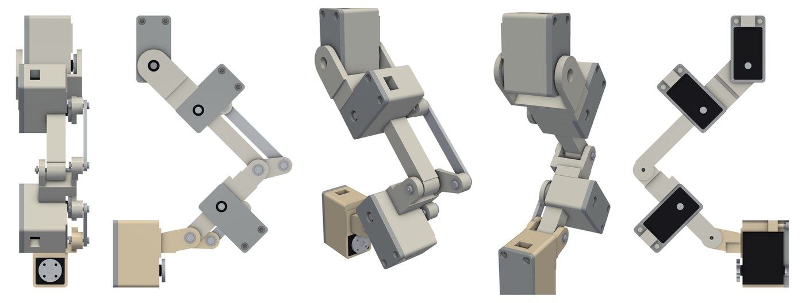
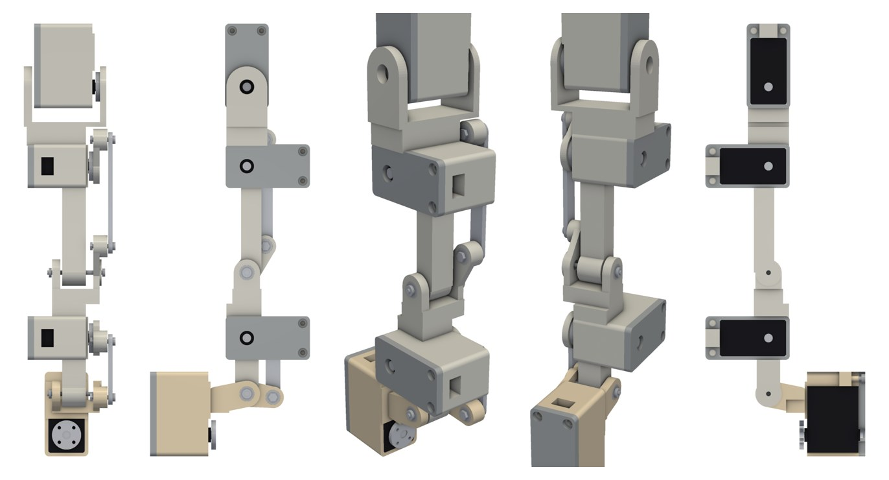
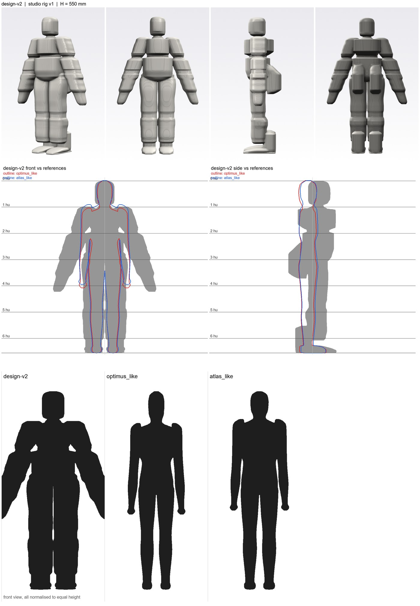

# R2a-v2: Adam baseline v2 (2026-10-19) — PROVISIONAL

**Task:** T-20261019-4ab5. **Status:** PROVISIONAL. Nothing is ordered; the bench test (R1 §9) is still the gate for the main order. No gate threshold and no spec.yaml value was changed.

## 1. Answer first

| Decision | Recommendation | Why (one line) |
|---|---|---|
| **L5c** (knee and ankle servos moved up, 1:1 parallelograms) | **Drop it** | Real CAD works (ROM, gate) but the look gain is small and partly reversed, and it needs a custom-cut aluminium coupler, double bearings, a crank that fails the fall case at 4.3 mm PETG, extra play and harder assembly (§3). |
| **L9a** (longer arms: upper arm 0.20 H, forearm 0.23 H) | **Keep it** | Engine-neutral (strict 1.245 vs 1.247), SIL 18/18. R5 reach +7 mm at 0.55 m, and the low-table gap is gone. Cost $0. The critic split on the look (one order each way). |
| **v2 baseline** | **V2a = R1 Path 1 at 0.55 m + longer arms + a 2nd bus adapter** | Concept: `variants/adam/concepts/V2a-0p55-longarm.yaml` (0.60 m: `V2a-0p60-longarm.yaml`). R1 total ≈ **$1,545** against the $1,600 lock. |
| **R5 at a 0.40–0.45 m table** | **Not met at 0.55 m**, even with the longer arms | Reach is 0.150–0.391 m at 0.55 m. At 0.60 m it is 0.150–0.194 and 0.219–0.422 m (0.40 m yes, 0.45 m no). Above that, the forearm meets the table edge (§5). |

## 2. Engineering table: v2 vs R1

The R1 rows are re-run at this HEAD (post-merge pickup planner), so all three columns use the same code.

**Gate sets:**
- strict = datasheet;
- half = ADR 0014 factors taken halfway;
- cal = ODM-calibrated.

**Bounds:** 13 (the 10 tornado bounds + benchmark-fit mass + shelled + low SoC).

**Runtime:** the engine's Tattu 1300 value; the build pack is the GNB 1850, so multiply by 1850/1300 as R1 did.

| 0.55 m | **R1** (`R1-P1r-0p55`) | **V2a: R1 + L9a** | V2b: R1 + L5c + L9a |
|---|---|---|---|
| Mass (engine) | 4.005 kg | 4.005 kg | 4.005 kg (+~60 g of linkage parts, not modelled; inside the shelled ×1.2 bound) |
| Gait chosen | 40° / 0.5 s | 40° / 0.5 s | 40° / 0.5 s |
| Worst margin strict / half / cal | 1.247 / 1.571 / 1.891 (hip roll) | **1.245 / 1.569 / 1.889** (hip roll) | 1.245 / 1.569 / **1.861 (knee: the assumed 5% linkage loss)** |
| Bounds passed strict / half / cal | 10 / 11 / 11 of 13 | 10 / 11 / 11 | 10 / 11 / 11 |
| Bounds failing (cal) | armature +50%, walking speed ×1.5 | same | same |
| R10 at 0.45 N·s (5 scenarios) | all pass, weakest 0.669 N·s | all pass, 0.670 | all pass, 0.670 |
| Monte Carlo p95 peak / stall (64 samples) | 0.87 (hip pitch) | **0.86** (hip pitch) | 0.87 (hip pitch); knee 0.75 vs 0.72 |
| Engine verdict | FAIL (pickup_0.45m invalid; MC p95 > strict 0.70) | FAIL (same two reasons) | FAIL (same) |
| Runtime, mixed (1300 → 1850 mAh) | 28.0 → ~40 min | 28.0 → ~40 min | 27.6 → ~39 min |
| Peak bus current (frozen motions) | 7.31 A (leg branch 4.48 A) | 7.33 A (4.46 A) | 7.26 A (4.79 A) |
| SIL runtime scenarios (`oh runtime`, 18) | 18/18 (T-20261019-2adc) | **18/18** | 18/18 |
| R5 reachable table tops | 0.150–0.159, 0.206–0.384 m | **0.150–0.391 m** | = V2a (same arm and leg ranges) |
| R1 total (+ $25 catalog additions) | $1,539 | **$1,545** (+$6: 2nd bus adapter) | $1,587 (budget bearings) / $1,675 (quality bearings, over the lock) |

**At 0.60 m (bench-conditional, only if the STS3250 stall at 11.1 V is ≥ ~1.3× datasheet):**

| | R1 0.60 | V2a 0.60 |
|---|---|---|
| Worst margin strict / half / cal | 1.024 / 1.290 / 1.453 (knee) | 1.023 / 1.289 / 1.463 (knee) |
| Bounds strict / half / cal | 4 / 10 / 11 of 13 | 4 / 10 / 11 |
| MC p95 / stall | 1.01 (hip roll) | 0.96 (hip roll) |
| R10 weakest | 0.661 N·s | 0.664 N·s |
| Runtime / peak current | 24.9 min / 9.35 A | 25.0 min / 10.26 A |
| R5 reach | 0.15–0.163, 0.191–0.422 m (R1 review) | 0.150–0.194, **0.219–0.422 m** |
| Cost | $1,556 | $1,562 |

**Reading.**
- The longer arms change nothing in the legs. Arm demand at the top of the reach is at most 0.38 of stall (elbow, strict margin 1.83).
- L5c costs about 1.5% of calibrated knee margin, through the assumed 5% loss. Ball-bearing pins compute to ≥ 0.99 efficiency, so this is a conservative bound.
- **The bus needs a second adapter (+$5).** The SIL found that 23 servos on one adapter take ~9–10 ms per cycle, which leaves no room for 100 Hz control. The adapter is in the V2a cost line.

Sources:
- `variants/adam/design/v2/results/cal_*.{json,md}`;
- `variants/adam/generated/concept/<id>/report.md` (64-sample MC);
- `variants/adam/generated/concept/<id>/pickup_range.md`;
- `variants/adam/design/v2/results/runtime_*.txt`, `cost.md`, `compare.json`.

## 3. L5c linkage in real CAD (the go/no-go evidence)

`variants/adam/cad/linkages/l5c.py` builds the left leg, from the hip-pitch cradle down to the ankle-roll heel block. It uses only the CAD-foundation library and helpers:
- `servo_housing`, `horn_mount`, the 623ZZ/MR105ZZ components, ISO screws;
- `dfm.yaml` seats and clearances.

The closed chains are tree links with slave joints. `check.py` drives them together and uses the foundation's own collision test.

### 3.1 Design (0.55 m landmarks: hip 275, knee 148.5, ankle 66 mm)

| | Knee | Ankle |
|---|---|---|
| Servo | STS3250 in the thigh, laid fore-aft, **axis 72.5 mm above the knee** (z 221) | STS3215 in the calf, axis 38 mm above the ankle (z 104), **body forward (shin)** |
| Cranks | r 22 mm; θ = 35° + q, so the window is **35–145°** over q 0–110° | r 18 mm; θ = 97.5° + q, so the window is **37.5–122.5°** over q −60…+25° |
| Coupler | 6061-T6, 3 × 10 mm, 72.5 mm long | same bar, 38 mm |
| Pins | 2× 623ZZ per pin (bored from both faces, 1.6 mm shoulder ring). M3×16 12.9 low-head screw clamps coupler + washer + inner races + spacer, held by a DIN 439 thin nut | same |
| Joint axle | M3 through 2× 623ZZ (one per clevis plate), clamped to the thigh tongue | same, clamped to the shank tongue |

**Stack across y**, with the servo face at +13 mm so the cover stays at the R1 medial limit:

| Item | y (mm) |
|---|---|
| Horn | 15.3–18.3 |
| Crank plate | 18.3–22.6 (pin boss to 27.9) |
| Coupler | 28.4–31.4 |
| Screw head | to 33.4 |

The coupler has to run **outside** the horn stack. Its pin sweeps over the servo body, so no plane inside the stack is free.

**Changes forced by the checks:**
- **Knee servo lowered 23 mm** from the packaging layout (244 → 221 mm). The input-crank boss hit the hip fork, and the layout ignored the hip-pitch sweep. This is the clash flagged in the pause handoff.
- **Calf servo body turned forward.** With the body backward, the heel block (ankle-roll servo) reached the calf housing at +25° plantarflexion.
- **Thin nut instead of DIN 934.** A 2.4 mm nut sits 0.65 mm over the housing lip, under the 1.0 mm moving gap.
- **Clevis gap opened to 1.2 mm.**
- **Column narrowed** to clear the knee servo cover.
- **Tapered cranks** (hull of the hub and pin discs) for bending strength.

### 3.2 Checks

| Check | Result |
|---|---|
| Coupled ROM sweep (5° steps, 0.25° refine, 1 mm moving gap) | **free** over hip pitch −110…+40°, knee 0…110°, ankle −60…+25°, and ankle through its range at knee 90°. The squat, deep squat, step-forward and pickup poses (rom.DEFAULT_POSES) are free. Neither linkage comes within 35° of its change point. |
| Geometry gate (`run_gate`) | **PASS.** Every part passes solid, STEP round trip, STL, walls and bed. The assembly has 0 clashes and 0 tight gaps. |
| Assembly access (`access.analyse`) | **FAIL as planned in a straight line**, which shows the real assembly burden. (1) The inner bearing of each 2-bearing boss, and the output-crank bearings, have to be pressed on the bench before the crank goes onto the horn or the knee is pinned. The per-link bench subassemblies (cranks, couplers, ankle cradle) are assemblable. (2) Both relocated servos come out "stuck" because the planner puts the cover before the servo; the same housing helper passes on the CAD-foundation leg, so this is an ordering artefact to confirm. (3) Two horn screws per input crank sit under the coupler once it is assembled; to service them the lower pin comes out first. (4) The pin nuts sit in 2–5 mm gaps and must be held with a thin wrench, which the tool does not model. The R1 hip cradle and heel block are excluded as already validated. |

### 3.3 Real front-view widths vs R1

Measured as true mesh sections, hardware included.

| Region | **L5c CAD (0.55 m)** | R1 CAD-foundation leg (forks) | Packaging-study estimate |
|---|---|---|---|
| Knee joint line (±10 mm) | **39.5 mm** (depth 21) | 57.5 mm (depth 30) | 32 mm |
| Thigh between the knee servo and the knee | 36.4 mm | 48.0 mm | n/a |
| Knee-servo level (upper thigh) | **58.6 mm**, offset laterally (−27.2…+31.4) | 52 mm fork at the knee | 52 mm |
| Calf-servo level | **60.0 mm** (−26.6…+33.4) | 57.5 mm (shank between forks) | 52 mm |
| Ankle joint line | 48.3 mm (the coupler head at +33.4) | 57.5 mm | 32 mm |

**What this means for the look.**
- The knee and ankle do get narrower.
- The upper thigh and calf get **wider than R1, on the outside**: the crank, coupler and screw stack reach +31…+33 mm against R1's +26.
- At the height of the hanging hand (z ≈ 206–247 mm), the outer thigh is 7.5 mm wider. With real CAD hard points, the R2a visible-gap rule could find **no arm cant up to 30°** that keeps B4's arm-to-body gap. R1 + L9a needs 19.5°.
- The parametric B4 rules could not shell the real L5c leg cleanly (HP fails, a lumpy shank: `variants/adam/design/v2/results/look.md`, rows V2b-cad).

### 3.4 Strength

The analytic check is `variants/adam/cad/linkages/analysis.{py,md}`. The FEA strength gate (T-20261019-a026) had not merged when this ran; flag the linkage for it.

| Item | Knee: stall at the window end | Knee: fall F1 (0.10 m drop, n = 20, 11.1 N·m) | Ankle: fall F1 |
|---|---|---|---|
| Coupler force | 389 N | 521 N | 440 N |
| 6061 coupler: yield / buckling SF | 14.5 / 7.5 | 10.8 / 5.6 | 12.8 / 24 |
| M3 12.9 pin shear SF | 8.4 | 6.3 | 7.5 |
| 623ZZ load per bearing / C0r 218 N | 0.89 | **1.20** | 1.01 |
| PETG seat pressure SF (target 3) | 2.6 | **1.9** | 2.3 |
| PETG crank bending (4.3 mm, tapered), SF vs XY | 2.6 | **1.16** | 2.9 |
| Clamp slips (μ·preload·2 = 360 N) | yes, above ~0.93 stall at the window end | yes | yes |

**Verdict.** The linkage survives walking and stall, but **the knee fails the fall case.**
- The crank bends at SF 1.16.
- The bearings reach 1.2 × C0r (they brinell).
- The seats reach SF 1.9 against the 3 target.

**Fixes, each with its own cost:**

| Fix | Cost |
|---|---|
| Aluminium cranks (scaling gives SF ~5.9) | Another custom-machined part |
| Or PETG plates about 2.5× thicker | Widens the stack again by ~6 mm |
| Bigger bearings | Wider bosses |

**A printed coupler is not an option.** It buckles at stall: PETG E = 1.68 GPa gives about 40 N at 3 mm thick. The off-the-shelf alternative, an RC M3 turnbuckle with ball links, buckles at ~340 N, and its play is unmeasured.

### 3.5 Play, and its effect in the engine

**Lost motion along the coupler**, from dfm.yaml and the bearing data, converts to output angle as (2·δ_pin + δ_axle) / (r·sin θ):

| Case | Added backlash, mid range / at the window end |
|---|---|
| Clamped, tuned seats | 0.04 / 0.07° |
| **Nominal** | **0.21 / 0.36°** (knee); 0.20 / 0.33° (ankle) |
| Worst (clamp slips + seat one press step loose) | 1.8 / 3.2° (knee); 2.3 / 3.7° (ankle) |

**In the engine** (`variants/adam/design/v2/engine.py backlash`): this is a SENSITIVITY, an open-loop servo-in-the-loop replay of the frozen walk that needs closed loop (P5), and never a gate.
- With nominal linkage play on top of the 0.5° servo backlash, walk tracking RMS goes 0.367 → 0.396° (knee 0.88 → 0.98°) and the tether goes 1.38 → 1.48% BW.
- **With the worst-case play the open-loop replay falls.**
- So L5c needs well-tuned seats and a preload torque spec, and the play has to be measured on the bench.

### 3.6 Look: metrics and critic

| | P3 | P8a thigh taper | P8b shank taper | cant | Pass |
|---|---|---|---|---|---|
| V2a (R1 legs + L9a, B4 rules) | 0.390 | 0.956 ✗ | 0.992 ✗ | 19.5° | 13/19 |
| V2b-est (L5c at the packaging estimate, optimistic) | 0.390 | **0.485** | 0.603 ✗ | 19.5° | 13/19 (S3b leg bumps 5 ✗) |
| V2b-cad (L5c at the real CAD) | 0.438 ✗ | not computable (legs merge) | not computable | > 30° (gap rule unmet) | 9/16 |

**Critic** (blind, both orders, advisor only; `docs/design-method/R2a-v2/critic/rounds.json`):
- Even the **optimistic** L5c (V2b-est) beat V2a in both orders by a "modest" / "small" margin. The reason given: a visible knee break instead of a "trouser slab".
- Both still read as **toy**. The critic named the stepped shank as a new cost.
- The real CAD leg is wider at the upper thigh and calf than that estimate.

**Conclusion.** The look gain the critic rewarded is the knee break, and B4's hand-styled legs already partly provide it (P8a 0.86). It does not justify:
- custom metal;
- 24 extra bearings;
- a fall-case fix;
- extra play;
- more assembly steps;
- +$42–130.

## 4. Silhouette v2

`variants/adam/design/profiles.yaml` is now v2. It is written by `variants/adam/design/v2/profiles_v2.py`:
- the B4 Atlas-capsule head, torso and legs, unchanged;
- arms re-fitted around the longer-arm hard points, cant 19.5° by the visible-gap rule (B4 used 21°).

| Metric | B4 (R2a) | **v2** |
|---|---|---|
| P3 shoulder / H | 0.397 | **0.390** |
| P8a / P8b | 0.860 / 0.938 | 0.861 / 0.938 |
| P2a neck | 0.110 | 0.110 |
| P10a foot | 0.238 | 0.238 |
| Numerics passed | 13/19 | 13/19 |
| HP enclosure | pass | pass |

**Critic, v2 vs B4:**
- **Split by order:** "baseline (low confidence: hands past the reference hand line)" against "candidate (less top-heavy, hands near mid-thigh)".
- So G5 is not established; treat the longer arms as look-neutral.
- Both read **toy**. The top changes in every report are the known hardware limits: shoulder width P3, neck P2a, foot P10a (R2a §9).

## 5. R5 reach (object 150 g, 50 mm behind the edge, whole-body planner)

| Concept | Reachable table tops | Above it |
|---|---|---|
| R1 0.55 m | 0.150–0.159, 0.206–0.384 m | table collision |
| **V2a 0.55 m** | **0.150–0.391 m** (the 0.16–0.20 m gap is gone) | table collision at 0.394 m |
| V2a 0.60 m | 0.150–0.194, 0.219–0.422 m | table collision at 0.425 m |

**R5 at 0.40–0.45 m is not met at 0.55 m.** The longer arms add 7 mm of top reach. Above ~0.39 m the hanging forearm and hand hit the table edge before the fingers reach the object: an orientation limit, not a length limit. This confirms R2a §9.4.

Only 0.60 m reaches a 0.40 m table, and nothing reaches 0.45 m without a wrist (packaging lever L9b). Demand at the top of the 0.55 m range is at most 0.38 of stall (elbow).

**The engine verdict stays FAIL** on the fixed `pickup_0.45m` case for every candidate.

## 6. Cost against the $1,600 lock

Source: `variants/adam/design/v2/results/cost.md`, R1 accounting.

| Configuration | R1 total + catalog additions | vs lock |
|---|---|---|
| R1 Path 1, 0.55 m | $1,539 | −$61 |
| **V2a (v2)**: + longer arms + 2nd bus adapter ($4.99) | **$1,545** | **−$55** |
| V2b: + L5c with budget bearings (50 × 623ZZ $15.24 shipped; C0r may be ~180 N) | $1,587 | −$13 |
| V2b: + L5c with quality bearings (VXB 3 × 10-pack $29.99) | $1,675 | **+$75, over** |
| V2a at 0.60 m | $1,562 | −$38 |
| V2a lean (STS3215 knees, after the bench + Q3) | $1,419 | −$181 |

**Price sources** (read 2026-10-19):
- 623ZZ: NSK ratings via vendor listings; [VXB 10-pack](https://vxb.com/products/623zz-10-bearing-shielded-3x10x4-miniature) $29.99; eBay 50-pack $10.39 + $4.85.
- 6061 bar: [Speedy Metals 1/8" × 3" × 12"](https://speedymetals.com/p-2230-18-x-3-6061-t6511-aluminum-extruded.aspx) $5.31.
- Bus adapter: the catalog line.
- M3 hardware ($10) and shipping on the bar ($8) are ESTIMATES.

## 7. Risks

1. **R5 at 0.40–0.45 m is unmet at 0.55 m.** It needs 0.60 m (bench-gated) for 0.40 m, plus a wrist for 0.45 m, or the maintainer redefines R5's table height.
2. **The engine verdict is still FAIL for every candidate:**
   - the 0.45 m pickup is invalid;
   - the strict MC p95 is 0.86 against the 0.70 gate. It passes only on the calibrated set, and the bench test is what validates that set.
3. **The longer arms' look is unproven.** The critic split; hands sit below the reference hand line. Reversible: they are link lengths only.
4. **If L5c is kept anyway:** the fall-case crank and bearing failures, custom metal, play sensitivity (the worst case falls in the open-loop replay), and assembly order (§3.2).
5. **Toolkit gaps found (for the commander):**
   - `python -m openhumanoid.runtime scenarios` ignores `--concept`. The wrapper `v2/runtime_scenarios.py` works around it.
   - The access planner cannot express bench-pressed bearings or "servo before cover" ordering.
   - The capsule styling rules assume legs symmetric about the leg plane. An opt-in `REFINE["leg_cy_follow"]` was added to `packaging/capsule.py`; the default is unchanged and `layout.py --check` is still IDENTICAL.
6. **Servo feature dimensions are still estimates** (the horn stack sets the coupler plane). Downloading vendor STEP files needs the maintainer's direct go-ahead in this session; it was not done.

## 8. Questions for the maintainer (≤ 3)

1. **Drop L5c and lock v2 = R1 + longer arms** (V2a, $1,545)? Keeping L5c needs custom aluminium (coupler, and cranks for the fall case), 24 bearings, +$42–130, and more play, for a modest look gain.
2. **R5 table height.** Accept ≤ 0.39 m at 0.55 m (coffee-table class), or keep 0.40–0.45 m? Keeping it means 0.60 m (bench-gated) for 0.40 m, plus a wrist-pitch servo for 0.45 m (+~$45, R2a §9).
3. **Longer arms on look alone.** The critic split one way each. Keep them for the reach and adult proportions, or revert to 0.19 / 0.21 H?

## Evidence index

**CAD:** `variants/adam/cad/linkages/`:
- `l5c.py` (builder);
- `check.py` (gate, coupled ROM, access, widths, renders);
- `analysis.py` (strength, play);
- `results/{rom,gate,access,widths,analysis,summary}.*`.

**Concepts:** `variants/adam/concepts/V2a-0p55-longarm.yaml` (v2), `V2a-0p60-longarm.yaml`, `V2b-0p55-l5c-longarm.yaml`, `V2b-0p60-l5c-longarm.yaml`.

**Engine:** `variants/adam/design/v2/`:
- `engine.py`, `run_engine.sh`, `table.py`;
- `results/cal_*`, `backlash_*`, `compare.json`;
- reports in `variants/adam/generated/concept/{R1-P1r-0p55…,V2a-0p55…,V2b-0p55…,V2a-0p60…}/`.

**SIL:** `variants/adam/design/v2/runtime_scenarios.py`, `runtime-adam-v2.yaml`, `results/runtime_*.txt`.

**Look:** `variants/adam/design/v2/look.py`, `profiles_v2.py`, `results/look.md`; renders and critic in `docs/design-method/R2a-v2/`.

**Cost:** `variants/adam/design/v2/cost.py`, `results/cost.md`.
